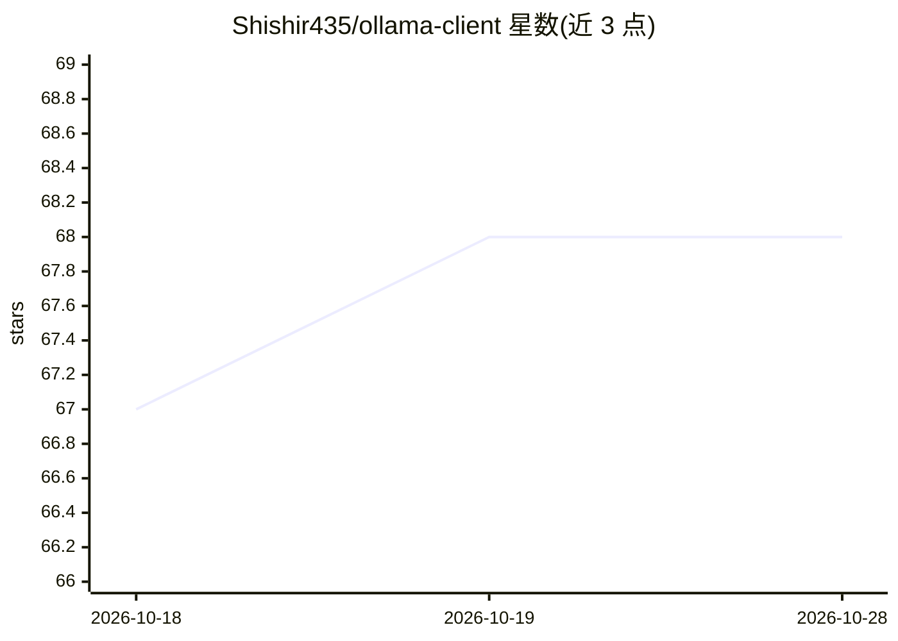

# Shishir435/ollama-client

⭐ 68 · TypeScript · MIT · 推送 2026-10-28 · [GitHub](https://github.com/Shishir435/ollama-client) · [官网](https://www.ollamaclient.in) · 个人维护

**浏览器侧栏扩展：与本地/自托管 LLM 私密对话**

Chrome/Firefox 浏览器侧边栏扩展，用于与本地或自托管 LLM 对话：内置 Ollama、LM Studio、llama.cpp 接入，可添加 vLLM、LocalAI、KoboldCPP 等 OpenAI 兼容服务及 Anthropic 作为自定义提供方。功能含流式对话、本地 RAG（混合关键词+向量检索，扩展内捆绑离线嵌入模型）、浏览器上下文附加（标签页/选中文本/文件/图片）、可选 Web 搜索与实验性浏览器 Agent。聊天记录、文件与嵌入数据存储在本机，无遥测。另提供可选的 olc CLI 用于启动 Ollama 及通过 Docker 运行 SearXNG。

## 筛选速览

| 维度 | 判定 | 备注 |
|---|---|---|
| AI 角色 | `ai-native` | 本体是模型或模型工具 |
| 许可风险 | `permissive` | MIT |
| 部署形态 | `library` | 以包/库形式分发 |
| 模型依赖 | local-ok | 支持本地模型 |
| 硬件要求 | — | 无带数字的原话,不猜 |
| 安装摩擦 | `low` | 无编译、无系统依赖或容器化 |
| 成熟度 | `idea` | |

## 能力要点

- 内置 Ollama / LM Studio / llama.cpp 提供方，支持 OpenAI 兼容服务器与 Anthropic
- 本地 RAG：混合关键词+向量搜索，扩展内捆绑离线嵌入
- 浏览器上下文附加与实验性浏览器 Agent（经 Chrome 调试器 API 驱动页面）
- 聊天记录、文件与嵌入本地存储，无遥测

## 适用场景

- 在浏览器侧栏直接与本地 LLM 对话，数据不出本机
- 对本地文件做检索增强问答
- 让模型读取当前网页内容或执行浏览器操作

## 场景标签

`聊天机器人` `RAG` `浏览器自动化` · 领域:效率与自动化

## 证据(README 行号)

> L3: A browser side panel for chatting with local and self-hosted LLMs. Your chats, files and embeddings stay on your mac
> L23: - **Streaming chat** in the side panel, with stop, edit-in-place, branching, tags, export, print and backup.

## 星数曲线

2026-10-18 67 → 2026-10-28 68（+1）

---
*卡片 v1 · prompt 1.4 · 生成 2026-10-24 · 置信度 mid · 依据 README sha `98621e571002` · [字段定义](../../DATASET.md)*
