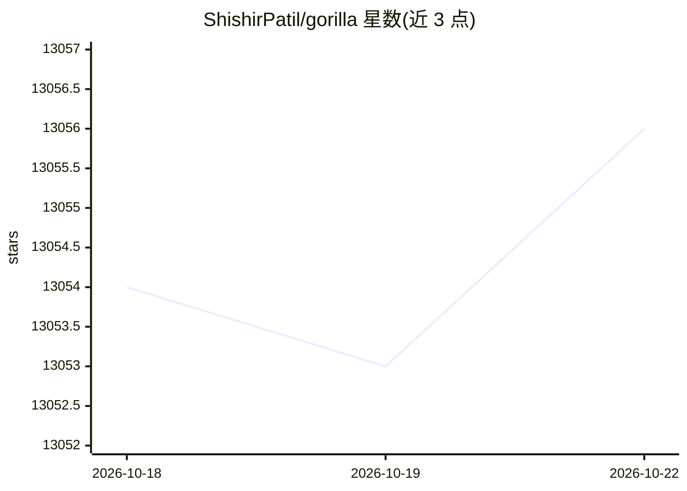

# ShishirPatil/gorilla

⭐ 13,057 · Python · Apache-2.0 · 推送 2026-10-17 · [GitHub](https://github.com/ShishirPatil/gorilla) · [官网](https://gorilla.cs.berkeley.edu/) · 组织维护

**让 LLM 输出正确 API 调用的模型与评测基准项目**

UC Berkeley 团维护的 LLM 工具调用项目集合：核心是 Gorilla 与 OpenFunctions 系列微调模型，给定自然语言请求生成语义与语法正确的 API 调用；仓库含推理代码、APIBench 数据集（1,600+ API）与评测代码。外围项目包括 Berkeley Function Calling Leaderboard（函数调用评测榜，V1-V4）、GoEx 动作执行运行时（事后验证/撤销）、RAFT 域内 RAG 微调方案、Gorilla CLI 与社区维护的 API Zoo 数据集。Apache 2.0 许可，可通过 pip 安装 CLI、克隆源码本地推理或 Colab 体验。

## 筛选速览

| 维度 | 判定 | 备注 |
|---|---|---|
| AI 角色 | `ai-native` | 本体是模型或模型工具 |
| 许可风险 | `permissive` | Apache-2.0 |
| 部署形态 | `library` | 以包/库形式分发 |
| 模型依赖 | — | README 未给出锁定关系 |
| 硬件要求 | — | 无带数字的原话,不猜 |
| 安装摩擦 | `low` | 无编译、无系统依赖或容器化 |
| 成熟度 | — | 结构信号不足 |

## 能力要点

- OpenFunctions 模型提供 OpenAI 兼容端点，支持多语言与并行函数调用
- BFCL 函数调用评测榜含多轮/多步/成本/延迟等维度
- GoEx 为 LLM 生成的动作提供事后验证、撤销与损害隔离
- API Zoo 社区维护的 API 文档数据集，支持检索增强训练

## 适用场景

- 用开源模型替代商业 API 实现函数调用
- 在 BFCL 上评测不同模型的工具调用能力
- 为领域任务用 RAFT 配方微调模型

## 场景标签

`模型评测` `微调` · 领域:评测与运维

## 证据(README 行号)

> L33: **Gorilla enables LLMs to use tools by invoking APIs. Given a natural language query, Gorilla comes up with the sem
> L42: |Gorilla OpenFunctions-V2|🤖 Model|Drop-in alternative for function calling, supporting multiple complex data types 

## 星数曲线

2026-10-18 13,054 → 2026-10-22 13,056（+2）

---
*卡片 v1 · prompt 1.4 · 生成 2026-10-20 · 置信度 high · 依据 README sha `25fb3eccacf2` · [字段定义](../../DATASET.md)*
