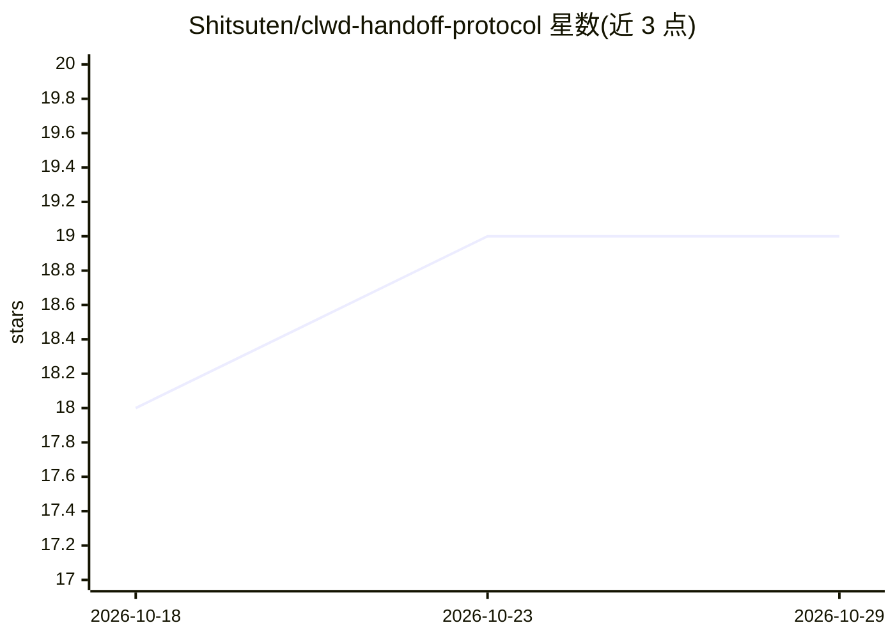

# Shitsuten/clwd-handoff-protocol

⭐ 19 · JavaScript · MIT · 推送 2026-07-17 · [GitHub](https://github.com/Shitsuten/clwd-handoff-protocol) · 个人维护 · 中文 README

**聊天会话向隔离工作区异步派发任务并可选择回流的协议**

一套“聊天会话↔隔离工作区”的异步任务派发协议：聊天侧模型通过 [clwd-task] 内联标签声明自包含任务，服务端解析后创建 durable job，由工作区模型在独立会话、独立工具权限与文件作用域中执行；结果进入返回架，由用户勾选后随下一条用户消息以低优先级参考材料形式注入，不自动污染聊天上下文。协议不依赖特定模型供应商或前端框架，仓库含教程、最小数据模型、零依赖 Node.js 参考实现与可运行示例。

## 筛选速览

| 维度 | 判定 | 备注 |
|---|---|---|
| AI 角色 | `ai-ecosystem` | LLM/agent 周边工具 |
| 许可风险 | `permissive` | MIT |
| 部署形态 | `None` |  |
| 模型依赖 | — | README 未给出锁定关系 |
| 硬件要求 | — | 无带数字的原话,不猜 |
| 安装摩擦 | `low` | 无编译、无系统依赖或容器化 |
| 成熟度 | — | 结构信号不足 |

## 能力要点

- [clwd-task] 内联任务声明格式与服务端解析规则（限制数量/长度、不信任标签内凭据）
- 结果经用户勾选后随下一条用户消息搭便车注入，不额外触发模型请求
- 返回架 selected 状态、injection_count 回执与幂等键等失败边界处理
- 零依赖 Node.js 参考实现（src/protocol.mjs）与可运行示例

## 适用场景

- 双前端架构（聊天陪伴+工程工作区）间派发与回收任务
- 让昂贵协调模型做判断、经济工作模型做工具循环的分层成本安排
- 长任务不阻塞聊天，用户自行决定何时带回结果

## 场景标签

`多智能体` · 领域:Agent 开发

## 证据(README 行号)

> L8: `CLWD Handoff Protocol` 是一套“聊天会话 ↔ 隔离工作区”的异步任务派发协议。
> L10: 它不是要把两个前端合并，也不是让一个昂贵模型从聊天、检索、改文件一路包办到底。聊天侧模型只负责理解用户、整理任务和决定是否外派；工作区侧模型在独立会话、独立工具权限和独立文件作用域里施工。结果返回后不会自动污染聊天上下文，而是先进

## 星数曲线

2026-10-18 18 → 2026-10-29 19（+1）

---
*卡片 v1 · prompt 1.4 · 生成 2026-10-28 · 置信度 high · 依据 README sha `800e46e421f4` · [字段定义](../../DATASET.md)*
