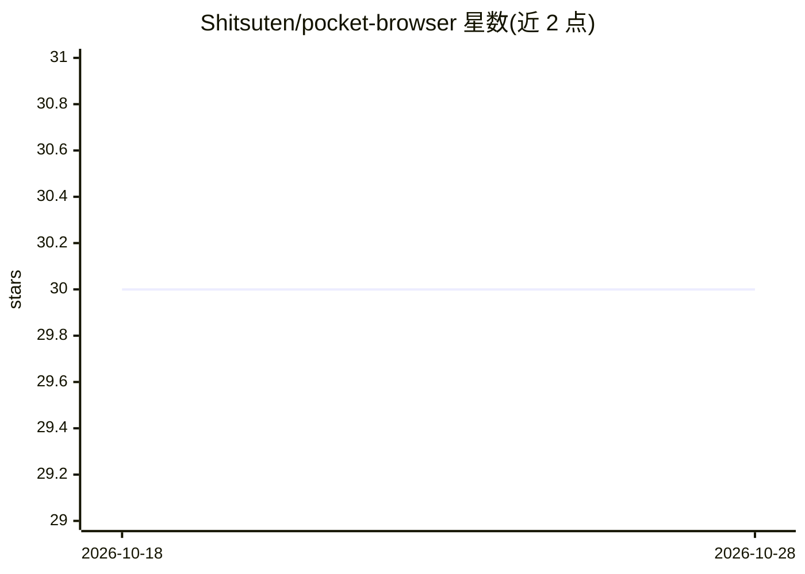

# Shitsuten/pocket-browser

⭐ 30 · Swift · GPL-3.0 · 推送 2026-07-13 · [GitHub](https://github.com/Shitsuten/pocket-browser) · 个人维护 · 中文 README

**把 iOS app 里的 WKWebView 接成受保护的远程调试/自动化通道**

由控制端经 HTTP 下发指令、server 中转（约 100 行无状态 Node.js）、手机 app 内的 WKWebView 通过 WebSocket 接收并执行的桥接工具。提供五个指令：ping/goto/js/html/screenshot，可复用 app 中已登录的 WebView 登录态，在真机 Safari 内核与真实移动网络环境下执行页面操作。面向已有 Browser 页面、需要远程调试或让脚本/agent 控制真实 WebView 的 iOS 开发者。附赠操作 x.com 的 agent skill；限制包括不自建浏览器壳、iOS 后台冻结需音频保活、token 为唯一门禁。

## 筛选速览

| 维度 | 判定 | 备注 |
|---|---|---|
| AI 角色 | `ai-ecosystem` | LLM/agent 周边工具 |
| 许可风险 | `viral` | GPL-3.0 |
| 部署形态 | `library` | 以包/库形式分发 |
| 模型依赖 | — | README 未给出锁定关系 |
| 硬件要求 | — | 无带数字的原话,不猜 |
| 安装摩擦 | `low` | 无编译、无系统依赖或容器化 |
| 成熟度 | — | 结构信号不足 |

## 能力要点

- 控制端→server→WKWebView 的 WebSocket 桥接架构，断线自动指数退避重连
- 五个指令：ping/goto/js/html/screenshot（截图返回 base64 PNG）
- 复用 app 已有 WKWebView 与登录态，无需服务器端处理 cookie
- 附带假手机脚本（npm run fake-phone）先验证 server 链路

## 适用场景

- 在真实 iPhone 的 WebKit 与网络环境下调试移动端页面
- 让脚本或 agent 远程操控我手机里已登录的 WebView 执行自动化操作
- 免去无头浏览器的常开机器与隧道维护成本

## 场景标签

`浏览器自动化` · 领域:效率与自动化

## 证据(README 行号)

> L3: 把手机 app 里已经存在的 `WKWebView`，接成一条受保护的远程调试/自动化通道。
> L23:   控制端 ──HTTP──▶  server  ──WebSocket──▶  手机 app 里的 WKWebView
> L29: - **server**（`server/server.mjs`）：一个很薄的中转。手机通过 WebSocket 连上来注册（只保留最新一个连接）；控制端通过 HTTP `POST /pocket/cmd` 下指令，server 

## 星数曲线

2026-10-18 30 → 2026-10-28 30（+0）

---
*卡片 v1 · prompt 1.4 · 生成 2026-10-26 · 置信度 high · 依据 README sha `bf9ce05b2b69` · [字段定义](../../DATASET.md)*
