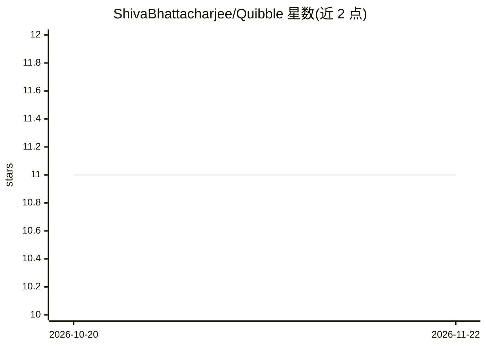

# ShivaBhattacharjee/Quibble

⭐ 11 · TypeScript · Apache-2.0 · 推送 2026-01-31 · [GitHub](https://github.com/ShivaBhattacharjee/Quibble) · [官网](https://quibble.theshiva.xyz/) · 个人维护

**基于 Gemini 的内容生成机器人：博客、歌词、社媒文案**

基于 NextJS 的 Web 应用，调用 Gemini API 生成博客文章、歌词、Instagram 文案等创作内容，用户输入想法后获得成型的文本产出。技术栈包括 NextAuth（Google OAuth 登录）、Tailwind CSS、TypeScript。本地运行需自行申请 Gemini API key 与 Google OAuth 凭据并填入 .env.local，通过 git clone 与 npm 安装启动。README 未说明部署方式之外的托管选项或使用限制。

## 筛选速览

| 维度 | 判定 | 备注 |
|---|---|---|
| AI 角色 | `ai-native` | 本体是模型或模型工具 |
| 许可风险 | `permissive` | Apache-2.0 |
| 部署形态 | `library` | 以包/库形式分发 |
| 模型依赖 | — | README 未给出锁定关系 |
| 硬件要求 | — | 无带数字的原话,不猜 |
| 安装摩擦 | `low` | 无编译、无系统依赖或容器化 |
| 成熟度 | — | 结构信号不足 |

## 能力要点

- 调用 Gemini API 生成博客、歌词、社媒文案
- NextAuth + Google OAuth 登录
- NextJS 14 + Tailwind CSS + TypeScript 构建

## 适用场景

- 为博客生成初稿内容
- 写社交媒体推广文案
- 创作歌词等创意文本

## 场景标签

`AI 写作` · 领域:内容生成

## 证据(README 行号)

> L25: Quibble, a content generation bot, simplifies and elevates your creative process. Whether crafting engaging blog po
> L46: - Gemini API key

## 星数曲线

2026-10-20 11 → 2026-11-22 11（+0）

---
*卡片 v1 · prompt 1.4 · 生成 2026-11-18 · 置信度 high · 依据 README sha `1687a5df534c` · [字段定义](../../DATASET.md)*
