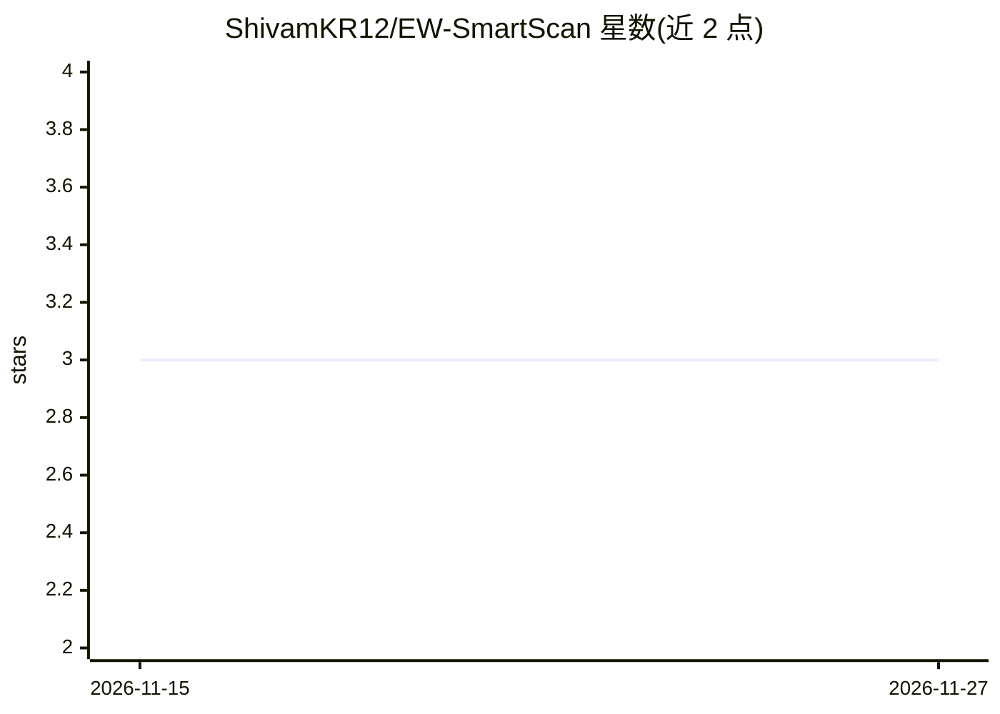

# ShivamKR12/EW-SmartScan

⭐ 3 · Python · 推送 2026-10-21 · [GitHub](https://github.com/ShivamKR12/EW-SmartScan) · 个人维护

**电子战/信号情报原型：模拟射频信号并做威胁分级与调度**

基于 Python、Streamlit 与 Plotly 的电子战与信号情报仿真原型：生成 30 MHz–3 GHz 的合成射频信号，按频段、功率与调制方式做启发式威胁评分，分为三级优先级，并动态重分配接收机驻留时间以持续跟踪高优先级威胁。提供实时频谱遥测仪表盘。为仿真环境，处理合成信号而非真实射频输入。

## 筛选速览

| 维度 | 判定 | 备注 |
|---|---|---|
| AI 角色 | `ai-native` | 本体是模型或模型工具 |
| 许可风险 | `none` | — |
| 部署形态 | `library` | 以包/库形式分发 |
| 模型依赖 | — | README 未给出锁定关系 |
| 硬件要求 | — | 无带数字的原话,不猜 |
| 安装摩擦 | `low` | 无编译、无系统依赖或容器化 |
| 成熟度 | — | 结构信号不足 |

## 能力要点

- 30 MHz–3 GHz 合成射频信号仿真，含多种调制类型建模
- 基于频段、功率、调制方式的启发式威胁评分与三级分类
- 动态调度引擎按威胁等级分配带宽与驻留时间
- Streamlit + Plotly 实时频谱与资源分配可视化

## 适用场景

- 演示电子战频谱监测与威胁分级的原型流程
- 研究动态接收机资源调度策略
- 教学场景中展示信号情报处理链路

## 场景标签

`数据分析` · 领域:效率与自动化

## 证据(README 行号)

> L5: The system simulates a dense electromagnetic spectrum environment, intercepts synthetic RF signals, applies heuristi
> L24: 2. **AI Threat Analyzer (`ai_analyzer.py`)**:

## 星数曲线

2026-11-15 3 → 2026-11-27 3（+0）

---
*卡片 v1 · prompt 1.4 · 生成 2026-11-22 · 置信度 high · 依据 README sha `116daa1ec8cb` · [字段定义](../../DATASET.md)*
