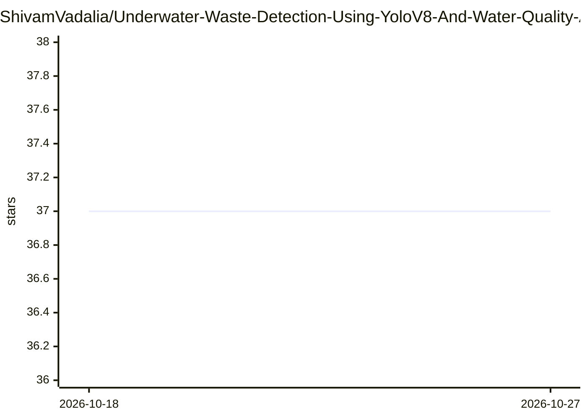

# ShivamVadalia/Underwater-Waste-Detection-Using-YoloV8-And-Water-Quality-Assessment

⭐ 37 · Jupyter Notebook · MIT · 推送 2026-03-30 · [GitHub](https://github.com/ShivamVadalia/Underwater-Waste-Detection-Using-YoloV8-And-Water-Quality-Assessment) · 个人维护

**水下垃圾检测与水质分类的机器学习项目**

名为 Neural Ocean 的课程/团队项目，提供三个模型：基于 YoloV8 的水下垃圾目标检测（5000 张图像训练，输入图像先经 Dark Channel Prior 去噪）、基于 US EPA 与 WHO 化学指标规则的栖息地适宜性分类器、基于 XGBoost 的饮用水可否分类模型（600 万行数据训练）。技术栈为 Python、PyTorch 生态下的 Ultralytics YoloV8、Dark Channel Prior 算法与 XGBoost。README 未给出安装运行命令，仅列出作者、演示链接与截图。

## 筛选速览

| 维度 | 判定 | 备注 |
|---|---|---|
| AI 角色 | `ai-native` | 本体是模型或模型工具 |
| 许可风险 | `permissive` | MIT |
| 部署形态 | `None` |  |
| 模型依赖 | — | README 未给出锁定关系 |
| 硬件要求 | — | 无带数字的原话,不猜 |
| 安装摩擦 | `low` | 无编译、无系统依赖或容器化 |
| 成熟度 | — | 结构信号不足 |

## 能力要点

- YoloV8 水下垃圾目标检测（5000 张图像训练）
- Dark Channel Prior 算法做输入图像去噪
- XGBoost 水质可饮用分类（600 万行数据训练）
- 基于 US EPA/WHO 化学指标的规则分类器评估水生栖息地

## 适用场景

- 检测水下图像中的垃圾废弃物
- 根据化学性质判断水体是否可饮用
- 评估水体是否适合水生生物栖息

## 场景标签

`目标检测` · 领域:感知与多模态

## 证据(README 行号)

> L3: The project addresses the issue of growing underwater waste in oceans and seas. It offers three solutions: YoloV8 Al
> L20: - Can detect underwater waste based on input images.

## 星数曲线

2026-10-18 37 → 2026-10-27 37（+0）

---
*卡片 v1 · prompt 1.4 · 生成 2026-10-25 · 置信度 high · 依据 README sha `48e415d1055b` · [字段定义](../../DATASET.md)*
