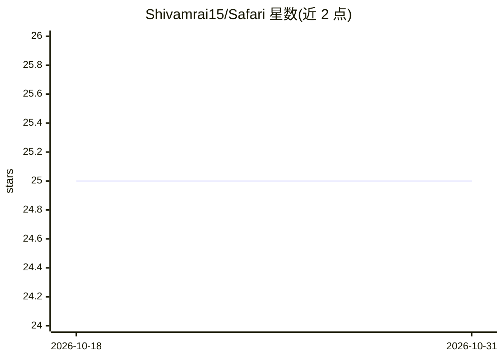

# Shivamrai15/Safari

⭐ 25 · TypeScript · 推送 2026-09-25 · [GitHub](https://github.com/Shivamrai15/Safari) · [官网](https://safari-music.vercel.app) · 个人维护

**开源音乐流媒体应用：播放歌单与好友共听**

基于 Next.js/React 构建的开源音乐流媒体 Web 应用，功能含订阅/非订阅分层（广告策略、歌单数量、拖动进度条等播放限制）、歌手关注、歌曲收藏、同步歌词、队列与历史管理，以及基于 Socket.io 的好友实时共听。技术栈使用 Prisma+MongoDB、NextAuth、Qdrant 向量库、Stripe 支付、Gemini，需配置约 20 个环境变量后自行部署运行。

## 筛选速览

| 维度 | 判定 | 备注 |
|---|---|---|
| AI 角色 | `ai-enhanced` | 去掉 AI 部分产品仍成立 |
| 许可风险 | `none` | — |
| 部署形态 | `None` |  |
| 模型依赖 | — | README 未给出锁定关系 |
| 硬件要求 | — | 无带数字的原话,不猜 |
| 安装摩擦 | `medium` | 含编译或系统依赖之一 |
| 成熟度 | — | 结构信号不足 |

## 能力要点

- 订阅与非订阅用户分层功能（广告、歌单数、播放限制）
- Socket.io 好友实时共听与队列共同管理
- 同步歌词、歌手关注、歌曲收藏、历史管理
- Stripe 支付与 Gemini、Qdrant 等服务集成（需配置环境变量）

## 适用场景

- 部署一个可自托管的音乐流媒体站点
- 与好友实时同步共听并共同管理播放队列
- 管理个人歌单、收藏与收听历史

## 场景标签

 · 领域:音乐流媒体/消费应用

## 证据(README 行号)

> L6:  The open-source music streaming application.
> L32: - Gemini
> L82: |`GEMINI_API_KEY`|""|

## 星数曲线

2026-10-18 25 → 2026-10-31 25（+0）

---
*卡片 v1 · prompt 1.4 · 生成 2026-10-27 · 置信度 mid · 依据 README sha `4b9f29362b2f` · [字段定义](../../DATASET.md)*
