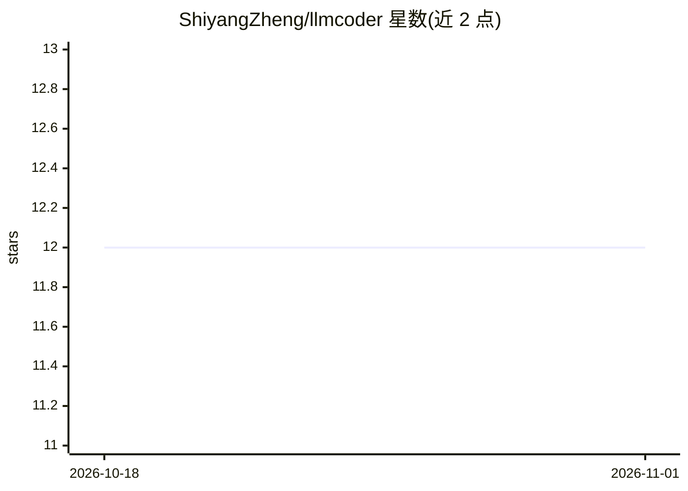

# ShiyangZheng/llmcoder

⭐ 12 · R · NOASSERTION · 推送 2026-05-08 · [GitHub](https://github.com/ShiyangZheng/llmcoder) · [官网](https://shiyangzheng.top) · 个人维护

**RStudio 内的 LLM 编程助手：注释生成代码、修错、多轮对话**

面向 R 用户的 RStudio addin：在注释行触发快捷键即在下方插入可运行的 R 代码，支持自动修复控制台报错（diff 预览后应用）、为选中代码生成行内解释，以及带会话上下文感知的多轮 Chat Panel（自动注入已加载包、全局对象、源文件与控制台历史）。支持 OpenAI、Anthropic、Ollama 等 8 类提供商，含本地 Ollama 免 API key 路径。经 CRAN 与 GitHub 安装。注意：API key 写入 .Rprofile 为明文，README 建议 .Renviron。

## 筛选速览

| 维度 | 判定 | 备注 |
|---|---|---|
| AI 角色 | `ai-native` | 本体是模型或模型工具 |
| 许可风险 | `none` | NOASSERTION |
| 部署形态 | `None` |  |
| 模型依赖 | local-ok | 支持本地模型 |
| 硬件要求 | — | 无带数字的原话,不猜 |
| 安装摩擦 | `low` | 无编译、无系统依赖或容器化 |
| 成熟度 | — | 结构信号不足 |

## 能力要点

- 注释行生成 R 代码，自动发送上文 40 行作为上下文（可配置）
- 控制台报错一键修复，diff 预览后应用
- 多轮 Chat Panel：会话上下文感知、代码块一键 Run、人格风格切换、转录导出
- 支持 8 类提供商，含 Ollama 全本地免 API key

## 适用场景

- 写注释直接生成 R 代码，不用切浏览器复制粘贴
- 控制台报错后快速拿到修复建议
- 在 RStudio 内以对话方式咨询统计与 R 编程问题

## 场景标签

`代码生成` · 领域:编码与开发

## 证据(README 行号)

> L14: **llmcoder** is an RStudio addin that integrates large language model (LLM)
> L16: shortcut, and receive working R code below — no browser, no copy-pasting.

## 星数曲线

2026-10-18 12 → 2026-11-01 12（+0）

---
*卡片 v1 · prompt 1.4 · 生成 2026-11-01 · 置信度 high · 依据 README sha `81250e5b0573` · [字段定义](../../DATASET.md)*
