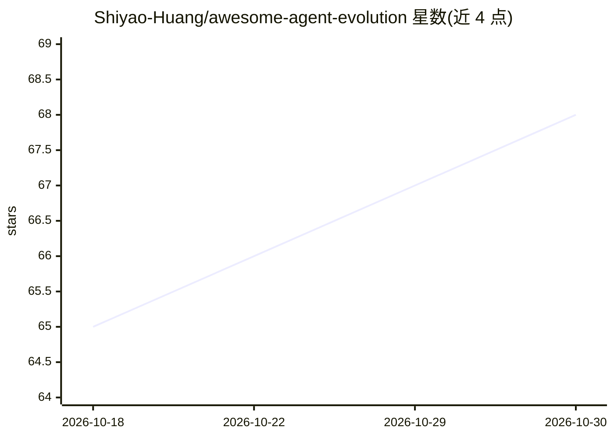

# Shiyao-Huang/awesome-agent-evolution

⭐ 68 · JavaScript · MIT · 推送 2026-08-03 · [GitHub](https://github.com/Shiyao-Huang/awesome-agent-evolution) · [官网](https://agent-evolution.com/) · 个人维护 · 中文 README

**AI Agent 自进化方向的开放 Survey 与证据地图**

面向研究自进化 AI Agent 的读者，提供 Survey 论文主线（8 章 LaTeX 草稿）、五类进化回路机制框架、代码自改进 Benchmark Matrix、项目 model card 报告和 Evolve-AGI Index 证据指数原型。证据管线从 GitHub/论文/博客原始材料加工为分类与报告，含 684 个分类仓库、292 篇项目报告。Index 权重标注为 editorial/proposed，未经同行验证；英文版长尾页面不宣称翻译完整。

## 筛选速览

| 维度 | 判定 | 备注 |
|---|---|---|
| AI 角色 | `ai-knowledge` | 知识聚合/清单类 |
| 许可风险 | `permissive` | MIT |
| 部署形态 | `None` |  |
| 模型依赖 | — | README 未给出锁定关系 |
| 硬件要求 | — | 无带数字的原话,不猜 |
| 安装摩擦 | `low` | 无编译、无系统依赖或容器化 |
| 成熟度 | `idea` | |

## 能力要点

- 五类进化回路机制框架与判断表（改什么/谁验证/如何保留/能否回滚）
- Evolve-AGI Index：七个信号加权的工作型证据指数原型
- 684 个分类 GitHub 仓库与 292 篇项目 model card 报告的证据管线
- 8 章 Survey 论文草稿（定义/分类/方法/系统/评估/框架/痛点/未来）

## 适用场景

- 研究者梳理自进化 Agent 领域的方法与系统分类
- 工程师判断 agent 项目是否具备可验证反馈与回滚能力
- 查证特定项目在证据链中的分类与状态

## 场景标签

`精选清单` `科研工具` · 领域:学习与行业

## 证据(README 行号)

> L3: **一份面向 AI Agent 自进化研究与实践的开放 Survey：帮你判断一个系统是真能从反馈中改进，还是只是在 demo 里看起来聪明。**
> L25: 1. 这不是普通 Awesome List，而是一份围绕“AI Agent 如何可靠地改进自己”的开放 Survey。

## 星数曲线

2026-10-18 65 → 2026-10-30 68（+3）

---
*卡片 v1 · prompt 1.4 · 生成 2026-10-24 · 置信度 high · 依据 README sha `a4a9fea4c9ea` · [字段定义](../../DATASET.md)*
