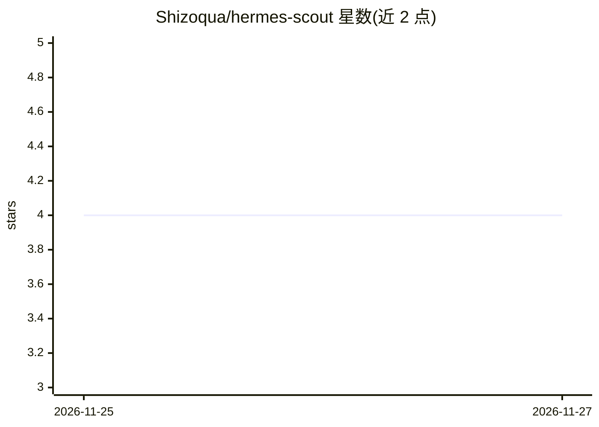

# Shizoqua/hermes-scout

⭐ 4 · Python · MIT · 推送 2026-11-24 · [GitHub](https://github.com/Shizoqua/hermes-scout) · [官网](https://shizoqua.github.io/hermes-scout/) · 个人维护

**本地文件语义+关键词混合搜索工具，Hermes 插件与 CLI**

对指定文件夹建立索引后提供语义与关键词混合检索：文件分块、经用户指定的 embeddings 服务端生成向量，与关键词索引一起存入单个 SQLite 文件；返回文件路径、行号范围与相似度分数。支持 PDF、Word、Excel、PowerPoint、OpenDocument 文本读取，默认通过本地 Ollama 等 OpenAI 兼容 /embeddings 端点运行，仅用 Python 标准库（零依赖），不编辑或上传文件，扫描版 PDF 与图片不读取。

## 筛选速览

| 维度 | 判定 | 备注 |
|---|---|---|
| AI 角色 | `ai-native` | 本体是模型或模型工具 |
| 许可风险 | `permissive` | MIT |
| 部署形态 | `library` | 以包/库形式分发 |
| 模型依赖 | local-ok | 支持本地模型 |
| 硬件要求 | — | 无带数字的原话,不猜 |
| 安装摩擦 | `low` | 无编译、无系统依赖或容器化 |
| 成熟度 | — | 结构信号不足 |

## 能力要点

- hybrid/semantic/keyword 三种排序模式，支持按 globs 过滤
- 读取 PDF/Word/Excel/PPT/OpenDocument，结果标注页码/幻灯片/工作表
- 增量索引仅重新嵌入变更文件；尊重 .gitignore 与隐藏文件跳过
- 同功能两种形态：Hermes 插件（scout_search/scout_similar 工具）与独立 CLI

## 适用场景

- 用自然语言在本地笔记、文档和代码里找相关段落
- 按错误码等精确标识符做关键词检索
- 找与某个文件或段落内容相似的其他文件
- 给 Hermes Agent 提供本地文件检索工具

## 场景标签

`语义搜索` · 领域:知识与检索

## 证据(README 行号)

> L32: - **As a Hermes Agent plugin**, adding two tools: `scout_search` (find passages) and
> L61: hermes-scout reads the folder you name, splits its files into chunks of whole lines and turns each
> L149: - **Local-first.** Works out of the box with Ollama, LM Studio, llama.cpp or vLLM on your own machine.

## 星数曲线

2026-11-25 4 → 2026-11-27 4（+0）

---
*卡片 v1 · prompt 1.4 · 生成 2026-11-25 · 置信度 high · 依据 README sha `95fc9d19df7f` · [字段定义](../../DATASET.md)*
