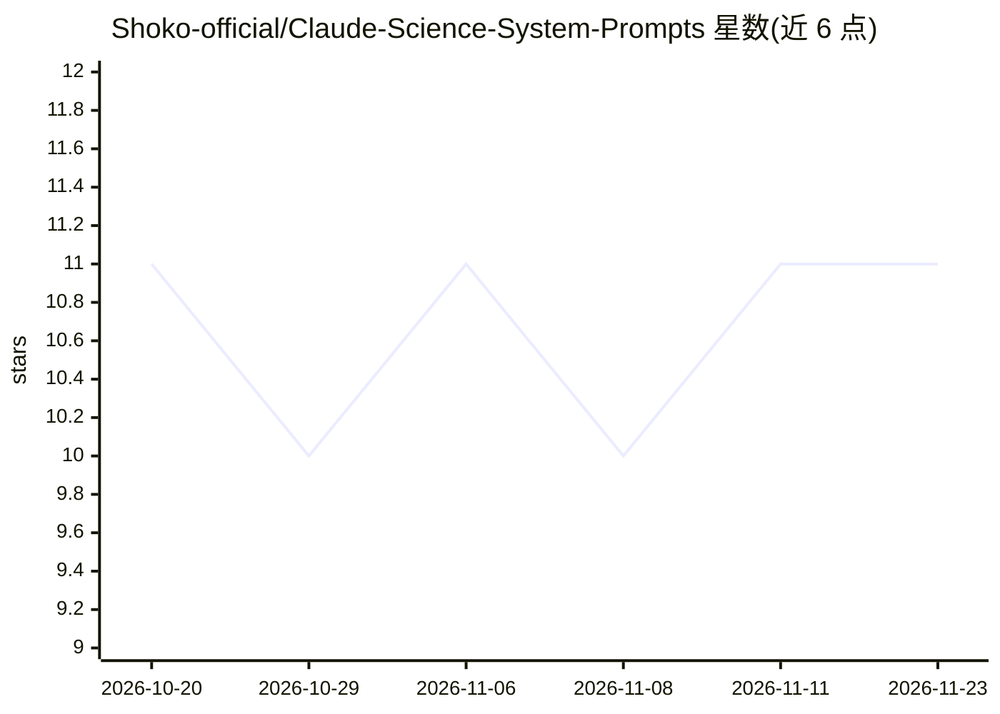

# Shoko-official/Claude-Science-System-Prompts

⭐ 11 · Python · Apache-2.0 · 推送 2026-08-09 · [GitHub](https://github.com/Shoko-official/Claude-Science-System-Prompts) · 组织维护

**面向科研人员的 Claude Science 系统提示词与技能集合**

该仓库收录 Claude Science 研究工作台相关的系统提示词、模块化提示片段、agent 技能（SKILL.md）与 Bio Research MCP 配置。内容按通用提示词、Claude Science 提示词、科研工作流、Bio Research 设置四类组织，目录约定明确区分完整提示词、组合用片段、技能与 MCP 服务器定义。Claude Science 本身被描述为带持久 Python/R 内核、托管工具权限与持久化产物的研究工作台。面向需要配置或研究此类科研 agent 系统的用户。

## 筛选速览

| 维度 | 判定 | 备注 |
|---|---|---|
| AI 角色 | `ai-knowledge` | 知识聚合/清单类 |
| 许可风险 | `permissive` | Apache-2.0 |
| 部署形态 | `None` |  |
| 模型依赖 | — | README 未给出锁定关系 |
| 硬件要求 | — | 无带数字的原话,不猜 |
| 安装摩擦 | `low` | 无编译、无系统依赖或容器化 |
| 成熟度 | — | 结构信号不足 |

## 能力要点

- 提供通用与 Claude Science 两套完整系统提示词及组合用 fragments
- 技能统一置于 skills/<skill-name>/，以 SKILL.md 为入口
- 包含 Bio Research 的 MCP 服务器定义与 connector 文档

## 适用场景

- 搭建或定制 Claude Science 科研工作台的提示词配置
- 为 Bio Research 场景配置 MCP 服务器与 connector
- 参考其目录约定组织自己的 agent 技能库

## 场景标签

`提示工程` `科研工具` · 领域:Agent 开发

## 证据(README 行号)

> L1: # Claude Science: Prompts, Skills, and MCP
> L5: System prompts, scientific skills, and Bio Research MCP configuration.
> L29: - Every skill is directly under `skills/<skill-name>/`; begin with its `SKILL.md`.

## 星数曲线

2026-10-20 11 → 2026-11-23 11（+0）

---
*卡片 v1 · prompt 1.4 · 生成 2026-11-18 · 置信度 high · 依据 README sha `4b4d8b42b7b3` · [字段定义](../../DATASET.md)*
