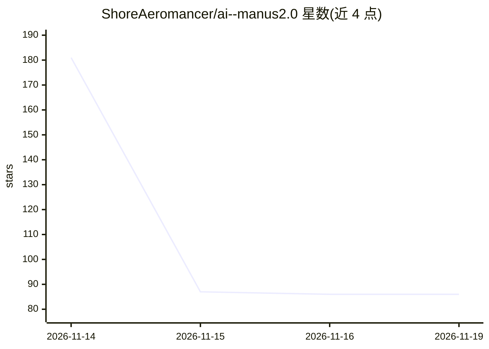

# ShoreAeromancer/ai--manus2.0

⭐ 86 · Apache-2.0 · 推送 2026-11-15 · [GitHub](https://github.com/ShoreAeromancer/ai--manus2.0) · 个人维护

**自主 AI Agent 系统：在沙箱中运行代码与控制浏览器**

Manus 是面向家庭、学习与轻量办公场景的自主 AI agent，描述为代替用户执行代码与浏览器操作：自主编写并执行脚本、导航网页、填写表单、完成多步骤任务，并以个人助手形式在后台待命。README 说明其最小配置为 64 位系统、双核 CPU、4 GB 内存，需联网与后台运行权限。README 以功能介绍与使用步骤为主，未提供具体的安装命令、代码仓库结构或模型接入说明。

## 筛选速览

| 维度 | 判定 | 备注 |
|---|---|---|
| AI 角色 | `ai-native` | 本体是模型或模型工具 |
| 许可风险 | `permissive` | Apache-2.0 |
| 部署形态 | `None` |  |
| 模型依赖 | — | README 未给出锁定关系 |
| 硬件要求 | — | 无带数字的原话,不猜 |
| 安装摩擦 | `low` | 无编译、无系统依赖或容器化 |
| 成熟度 | — | 结构信号不足 |

## 能力要点

- 自主执行代码与脚本（autonomous code execution）
- 浏览器控制：导航网页、填表、抓取信息
- 代码与浏览器操作可在同一工作流中衔接
- 支持多步骤任务的后台个人助手模式

## 适用场景

- 让学生整理研究笔记与运行小型脚本
- 远程工作者从多个网页收集数据
- 把重复性小任务委托给 agent 后台处理

## 场景标签

`AI 助手` `浏览器自动化` `编码 Agent` · 领域:效率与自动化

## 证据(README 行号)

> L10: - **Autonomous Code Execution:** Manus AI agent runs code on its own to complete tasks, so you can focus on decisio
> L18: Manus is an autonomous AI agent designed to run code and control a browser on your behalf. Instead of acting like a

## 星数曲线

2026-11-14 181 → 2026-11-19 86（-95）

---
*卡片 v1 · prompt 1.4 · 生成 2026-11-17 · 置信度 mid · 依据 README sha `637da4fbcded` · [字段定义](../../DATASET.md)*
