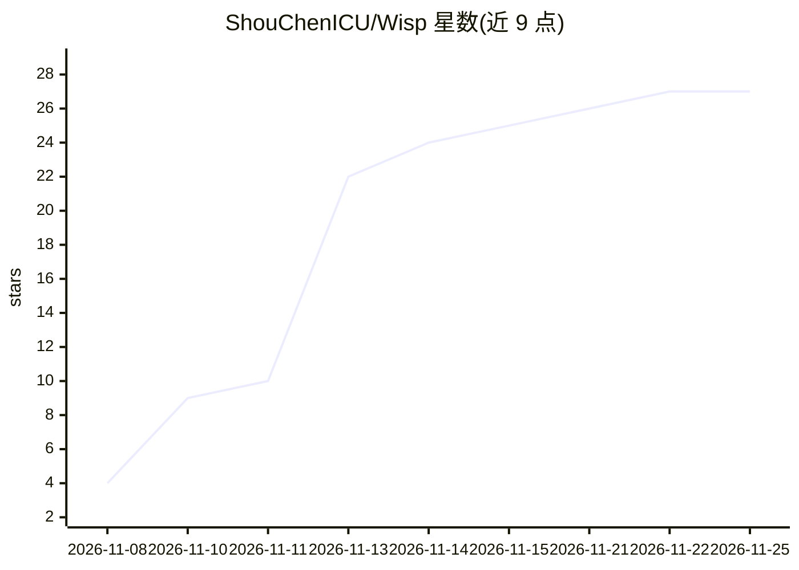

# ShouChenICU/Wisp

⭐ 27 · C++ · Apache-2.0 · 推送 2026-11-22 · [GitHub](https://github.com/ShouChenICU/Wisp) · 个人维护 · 中文 README

**ESP32 掌上硬件 Agent，按对话需求动态生成应用**

Wisp 是运行在 ESP32-S3 触屏硬件上的手持个人 Agent：用户语音对话，Agent 通过工具调用在设备上创建、修改、安装 Lua 场景应用（如番茄钟、时钟），全程无需重新编译或连接电脑。聊天、语音识别与合成均通过 OpenAI 兼容 API 接入，可自托管。提供 PC 模拟器供无硬件运行，固件基于 ESP-IDF 构建，支持多块开发板移植与 OTA 更新。设备端有 Lua 沙箱、write-only API key 与敏感操作确认机制。

## 筛选速览

| 维度 | 判定 | 备注 |
|---|---|---|
| AI 角色 | `ai-native` | 本体是模型或模型工具 |
| 许可风险 | `permissive` | Apache-2.0 |
| 部署形态 | `None` |  |
| 模型依赖 | local-ok | 支持本地模型 |
| 硬件要求 | — | 无带数字的原话,不猜 |
| 安装摩擦 | `medium` | 含编译或系统依赖之一 |
| 成熟度 | — | 结构信号不足 |

## 能力要点

- Agent 依需求在设备上动态创建与修改 Lua 应用，免重编译
- OpenAI 兼容的聊天/ASR/TTS 均可切换与自托管
- 提供 PC 模拟器，无硬件也可运行
- LAN 管理控制台、write-only API key、敏感操作设备端确认

## 适用场景

- 让设备根据口头需求即时生成番茄钟、天气等小应用
- 本地语音助手与提醒（待办到时亮屏响铃）
- 在模拟器上无硬件开发调试
- 移植到自定义 ESP32-S3 开发板

## 场景标签

`语音 Agent` `AI 助手` · 领域:对话与助手

## 证据(README 行号)

> L15: Wisp is your personal handheld agent. It can chat with you, has a memory of its own and, most importantly, can crea
> L22: - **Choose your models**: OpenAI-compatible chat, ASR and TTS, with switchable profiles.

## 星数曲线

2026-11-08 4 → 2026-11-25 27（+23）

---
*卡片 v1 · prompt 1.4 · 生成 2026-11-18 · 置信度 high · 依据 README sha `78bc3e260296` · [字段定义](../../DATASET.md)*
