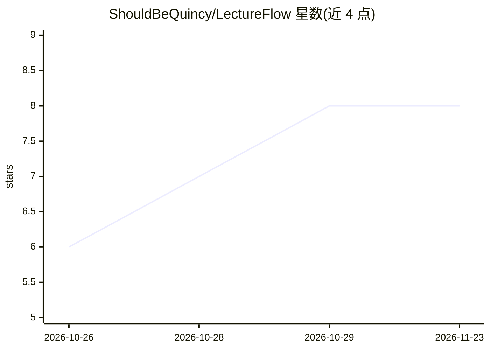

# ShouldBeQuincy/LectureFlow

⭐ 8 · Go · AGPL-3.0 · 推送 2026-11-18 · [GitHub](https://github.com/ShouldBeQuincy/LectureFlow) · 个人维护 · 中文 README

**本地讲座录音转写、纠错与翻译的桌面学习工具**

运行在用户自己电脑上的讲座工具：导入录音后本地逐句转写并带时间戳，从课程大纲和幻灯片构建术语表、用第二个模型清洗后修正误听词，再逐句翻译成用户语言；播放器中字幕独立于幻灯片显示，支持逐句回跳与精确到秒的引用导出。转写后端支持 NVIDIA GPU、Intel 核显/NPU、Apple MLX 与 Google Colab；文本纠正、摘要与翻译可接入多家模型服务商，也可仅用本地转写不上传任何内容。提供 Windows 安装包与 Apple Silicon dmg。

## 筛选速览

| 维度 | 判定 | 备注 |
|---|---|---|
| AI 角色 | `ai-native` | 本体是模型或模型工具 |
| 许可风险 | `viral` | AGPL-3.0 |
| 部署形态 | `desktop` | 安装包/桌面程序 |
| 模型依赖 | local-ok | 支持本地模型 |
| 硬件要求 | — | 无带数字的原话,不猜 |
| 安装摩擦 | `medium` | 含编译或系统依赖之一 |
| 成熟度 | — | 结构信号不足 |

## 能力要点

- 本地逐句转写并按大纲/幻灯片构建术语表修正误听词
- 播放器字幕独立分区，支持逐句回跳、循环与精确到秒的引用
- 转写设备可按电源状态在独显与 NPU 间切换，可借用 Google Colab GPU
- 导出双语字幕（VTT）与带时间戳引用的 JSON，供其他 AI 工具生成笔记

## 适用场景

- 把课程录音转成带术语修正的双语转写稿复习
- 第二语言学习者逐句对照听讲内容与母语翻译
- 听力或注意力受限的学生逐句回放讲座片段
- 导出带秒级引用的 JSON 供其他 AI 工具做可核查笔记

## 场景标签

`语音识别` · 领域:感知与多模态

## 证据(README 行号)

> L15: LectureFlow is a lecture tool that runs on your own computer. Drop in a lecture recording, and it transcribes the s
> L54: - Transcribes lectures on your own computer, sentence by sentence, with timestamps.
> L116: |Provider|Supports|In a sentence|

## 星数曲线

2026-10-26 6 → 2026-11-23 8（+2）

---
*卡片 v1 · prompt 1.4 · 生成 2026-11-20 · 置信度 high · 依据 README sha `3560a65c2073` · [字段定义](../../DATASET.md)*
