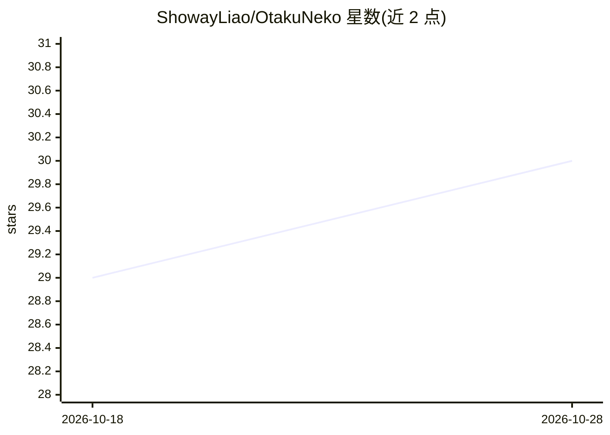

# ShowayLiao/OtakuNeko

⭐ 30 · Python · 推送 2026-10-28 · [GitHub](https://github.com/ShowayLiao/OtakuNeko) · 个人维护 · 中文 README

**给二次元爱好者的 LLM 番剧管理与分析私人助手**

面向个人用户的番剧管理与 AI 分析应用：同步 Bangumi/豆瓣收藏，基于 LangGraph ReAct Agent（7 个工具）提供动漫领域多轮对话，支持 DeepSeek/OpenAI/兼容 API 多模型切换与角色人格预设；另提供 AI 深度画像（雷达图、四象限分析、年度报告海报）、可视化排班表（CSV/iCal/TickTick 导出）、qBittorrent+RSS 追番下载。架构为 FastAPI 后端 + Next.js 前端，数据库支持 SQLite/PostgreSQL 双模式，可 Docker Compose 编排 5 个服务部署。README 自述处于 Beta 早期，功能迭代频繁。

## 筛选速览

| 维度 | 判定 | 备注 |
|---|---|---|
| AI 角色 | `ai-native` | 本体是模型或模型工具 |
| 许可风险 | `none` | — |
| 部署形态 | `self-host` | docker 或自建部署 |
| 模型依赖 | locked-api |  |
| 硬件要求 | — | 无带数字的原话,不猜 |
| 安装摩擦 | `low` | 无编译、无系统依赖或容器化 |
| 成熟度 | `idea` | |

## 能力要点

- LangGraph ReAct Agent 智能体，含查条目/搜声优/看评价等 7 个内置工具
- Bangumi + 豆瓣双平台收藏同步与多维筛选管理
- AI 深度画像：成分鉴定雷达图、四象限口味分析、年度报告海报生成
- SQLite/PostgreSQL 双模式，Docker Compose 一键编排 5 个服务

## 适用场景

- 同步并管理我的 Bangumi 番剧收藏
- 和懂动漫的 AI 助手对话查询条目、声优、评价并获取推荐
- 生成我的二次元口味画像和年度看番报告海报
- 用可视化排班表管理追番计划并导出到日历

## 场景标签

`AI 助手` `推荐系统` `数据分析` · 领域:效率与自动化

## 证据(README 行号)

> L33:  它能同步 Bangumi (bgm.tv) 收藏，通过 AI 深度分析你的二次元成分，
> L61: - **🧠 LangGraph ReAct Agent** — 从简单 LLM 链升级为具备 7 个 Tool 的思考-行动循环智能体
> L79:  支持多模型切换（DeepSeek / OpenAI / 兼容 API）

## 星数曲线

2026-10-18 29 → 2026-10-28 30（+1）

---
*卡片 v1 · prompt 1.4 · 生成 2026-10-26 · 置信度 high · 依据 README sha `2f3b12334ff6` · [字段定义](../../DATASET.md)*
