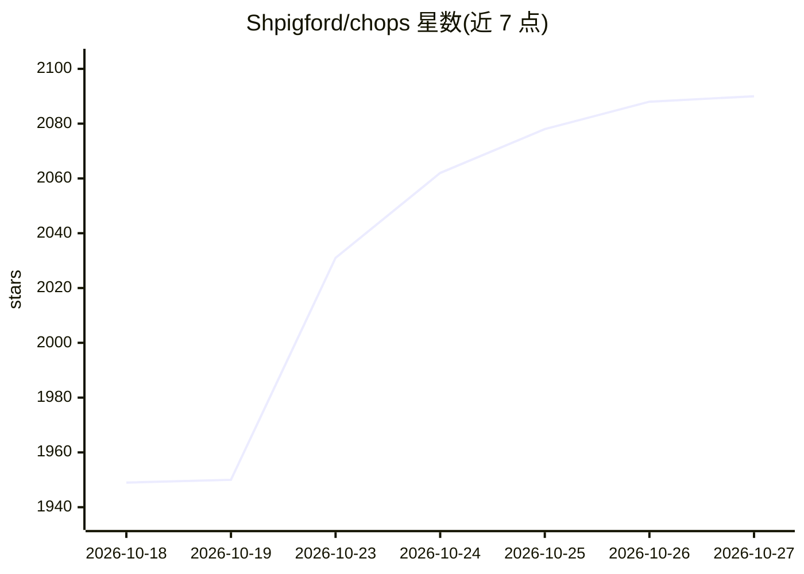

# Shpigford/chops

⭐ 2,090 · Swift · NOASSERTION · 推送 2026-08-23 · [GitHub](https://github.com/Shpigford/chops) · [官网](https://chops.md) · 个人维护

**管理多种编码 Agent 技能与 Agent 的 macOS 桌面应用**

原生 SwiftUI 编写的 macOS 应用，用于发现、组织和编辑多个编码 Agent 工具（Claude Code、Cursor、Codex、Windsurf、Copilot、Aider、Amp）的技能与 Agent 文件：扫描各工具的 dotfile 目录，提供等宽编辑器（Cmd+S 保存、frontmatter 解析）、集合组织、全文搜索、按工具生成样板、FSEvents 实时文件监听，并可从 skills.sh 注册表及 OpenClaw/Hermes 远程服务器浏览安装技能。无沙箱以读取全盘 dotfile，无自动化测试。终端用户可下载发布版，从源码构建需 Xcode 与 xcodegen。

## 筛选速览

| 维度 | 判定 | 备注 |
|---|---|---|
| AI 角色 | `ai-ecosystem` | LLM/agent 周边工具 |
| 许可风险 | `none` | NOASSERTION |
| 部署形态 | `library` | 以包/库形式分发 |
| 模型依赖 | — | README 未给出锁定关系 |
| 硬件要求 | — | 无带数字的原话,不猜 |
| 安装摩擦 | `medium` | 含编译或系统依赖之一 |
| 成熟度 | — | 结构信号不足 |

## 能力要点

- 扫描 7 种工具的技能/Agent 目录并去重（符号链接识别）
- 内置等宽编辑器，支持 frontmatter 与 Cursor .mdc 解析
- 从 skills.sh 注册表及 OpenClaw/Hermes 远程服务器发现并安装技能
- FSEvents 实时文件监听与全文搜索

## 适用场景

- 在一个界面统一管理散落在各 dotfile 目录的技能与 Agent
- 为不同工具创建符合其格式的新技能样板
- 浏览和安装 skills.sh 上的技能

## 场景标签

`提示工程` · 领域:Agent 开发

## 证据(README 行号)

> L13: One macOS app to discover, organize, and edit coding agent skills and agents across Claude Code, Cursor, Codex, Win
> L17: - **Multi-tool support** — Claude Code, Cursor, Codex, Windsurf, Copilot, Aider, Amp
> L29: Chops scans these directories for skills and agents:

## 星数曲线

2026-10-18 1,949 → 2026-10-27 2,090（+141）

---
*卡片 v1 · prompt 1.4 · 生成 2026-10-21 · 置信度 mid · 依据 README sha `e46f21966edb` · [字段定义](../../DATASET.md)*
