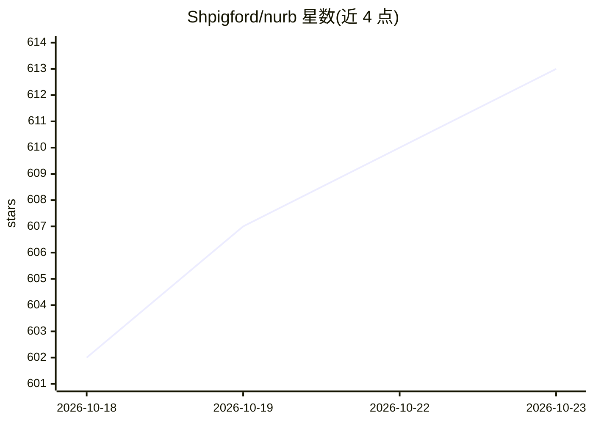

# Shpigford/nurb

⭐ 613 · Python · NOASSERTION · 推送 2026-09-16 · [GitHub](https://github.com/Shpigford/nurb) · [官网](https://nurb.dev) · 个人维护

**让 AI 按口述生成可 3D 打印零件的 CAD 工具**

面向 3D 打印用户的 agentic CAD 工具：用自然语言描述零件，AI 生成基于 OCCT 内核的真实 B-rep 实体模型，nurb 对实体跑 13 条可打印性规则（悬垂、薄壁、浮空区域等）、给出打印时间与耗材克数、体素应力模拟，并导出内嵌打印参数的 3MF。建模、检查、查看与导出均本地运行，无需账号与云端。以 Mac 应用和 CLI（pip/uv）两种形式提供，需搭配用户已有的 AI 订阅。许可为 FSL-1.1-MIT（源码可用，两年后转 MIT）。

## 筛选速览

| 维度 | 判定 | 备注 |
|---|---|---|
| AI 角色 | `ai-native` | 本体是模型或模型工具 |
| 许可风险 | `none` | NOASSERTION |
| 部署形态 | `library` | 以包/库形式分发 |
| 模型依赖 | — | README 未给出锁定关系 |
| 硬件要求 | — | 无带数字的原话,不猜 |
| 安装摩擦 | `low` | 无编译、无系统依赖或容器化 |
| 成熟度 | — | 结构信号不足 |

## 能力要点

- 基于 OCCT 内核的真实 B-rep 实体建模（build123d），STEP 可导入 Fusion/FreeCAD
- 13 条可打印性规则直接作用于精确实体，检查结果定位到具体面
- 体素应力模拟给出受载、下垂量与破坏重量（对照层间粘合强度）
- 全流程本地运行：建模、检查、查看器与导出均离线可用

## 适用场景

- 用一句话让 AI 建模并打印自制零件（如吸尘器转接头）
- 打印前发现悬垂、薄壁、翘边等问题并定位到模型具体位置
- 通过滑杆微调参数后导出开箱即打的 3MF 文件

## 场景标签

 · 领域:CAD/3D 打印

## 证据(README 行号)

> L3: Tell your AI what you need printed. Watch the part take shape live. Print it.
> L5: nurb turns the AI you already pay for into a CAD partner for 3D printing. You describe the part in plain words, the 
> L61: Under the hood, a part is a small Python function the AI writes and you never have to read:

## 星数曲线

2026-10-18 602 → 2026-10-23 613（+11）

---
*卡片 v1 · prompt 1.4 · 生成 2026-10-21 · 置信度 mid · 依据 README sha `c640fd4c00df` · [字段定义](../../DATASET.md)*
