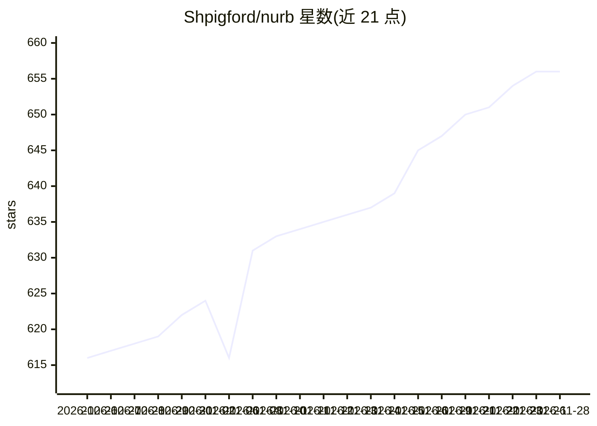

# Shpigford/nurb

⭐ 656 · Python · NOASSERTION · 推送 2026-11-27 · [GitHub](https://github.com/Shpigford/nurb) · [官网](https://nurb.app) · 个人维护

**用自然语言让 AI 生成可 3D 打印零件的桌面 CAD 应用**

面向 3D 打印用户的桌面应用：用户用日常语言描述零件，接入的 AI agent 编写 Python 参数函数生成 B-rep 实体（OCCT 内核），每个版本经 15 条可打印性规则检查（悬空、薄壁、翘曲等）并在实时查看器中呈现；参数以滑块调节，导出内嵌打印设置的 3MF，也可调本机 OrcaSlicer/Bambu Studio 估算打印时间与耗材。几何、检查、导出全部本地运行，AI 对话走云端订阅（Claude Code、Codex、Gemini、Cursor、Grok）。0.x 的 CLI 与 PyPI 包已移除。

## 筛选速览

| 维度 | 判定 | 备注 |
|---|---|---|
| AI 角色 | `ai-native` | 本体是模型或模型工具 |
| 许可风险 | `none` | NOASSERTION |
| 部署形态 | `library` | 以包/库形式分发 |
| 模型依赖 | locked-api |  |
| 硬件要求 | — | 无带数字的原话,不猜 |
| 安装摩擦 | `low` | 无编译、无系统依赖或容器化 |
| 成熟度 | — | 结构信号不足 |

## 能力要点

- AI 写 Python 参数函数生成 B-rep 实体，参数映射为查看器滑块
- 15 条可打印性规则检查精确实体，发现项定位到具体面
- 导出内嵌打印设置的 3MF，另支持 STL/STEP/GLB
- 零件尺寸必须记录测量方式，未实测的猜测会被标记

## 适用场景

- 用一句话生成台锯集尘口转接件等实用打印零件
- 打印前提前发现薄壁、悬空等设计问题
- 导出 3MF 直接交给切片软件双色打印文字件

## 场景标签

`编码 Agent` · 领域:编码与开发

## 证据(README 行号)

> L3: Tell your AI what you need printed. Watch the part take shape live. Print it.
> L5: nurb turns the AI you already pay for into a CAD partner for 3D printing. You describe the part in plain words, the 
> L21: The chat inside the app runs the agent you already have: Claude Code, Codex, Gemini, Cursor or Grok, on your own su

## 星数曲线

2026-10-26 616 → 2026-11-28 656（+40）

---
*卡片 v1 · prompt 1.4 · 生成 2026-11-24 · 置信度 mid · 依据 README sha `11248c67df7e` · [字段定义](../../DATASET.md)*
