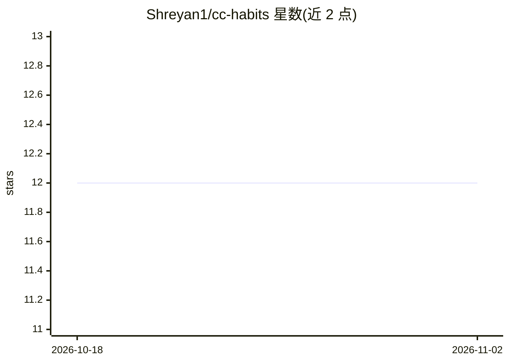

# Shreyan1/cc-habits

⭐ 12 · TypeScript · MIT · 推送 2026-08-03 · [GitHub](https://github.com/Shreyan1/cc-habits) · [官网](https://shreyan1.github.io/cc-habits/) · 个人维护

**AI 编码代理的跨工具本地记忆层，学习并同步个人编码风格**

面向使用多种 AI 编码代理的开发者的工具无关记忆层：通过 hooks 与 Git 集成被动学习用户真实编辑中的编码习惯，维护单一本地 habits.md 配置文件，并可自动写入 Claude Code、Cursor、Cline、Windsurf 等 9+ 平台的原生规则文件。本地优先，无遥测、无守护进程；仅在会话结束时做一次小型 LLM 抽取调用（默认本地 Ollama 可零成本离线）。提供新习惯隔离、置信度衰减、tombstone 与 .cc-habits-ignore 按仓库退出等护栏机制。

## 筛选速览

| 维度 | 判定 | 备注 |
|---|---|---|
| AI 角色 | `ai-ecosystem` | LLM/agent 周边工具 |
| 许可风险 | `permissive` | MIT |
| 部署形态 | `library` | 以包/库形式分发 |
| 模型依赖 | local-ok | 支持本地模型 |
| 硬件要求 | — | 无带数字的原话,不猜 |
| 安装摩擦 | `low` | 无编译、无系统依赖或容器化 |
| 成熟度 | — | 结构信号不足 |

## 能力要点

- 从真实编辑被动学习编码习惯，维护单一本地 habits.md
- cch sync 同步至 Claude Code/Cursor/Windsurf 等 9+ 平台原生规则格式
- 无守护进程、无遥测，hook 按需运行 <50ms，会话中零 LLM 成本
- 护栏机制：两会话毕业门槛、Learning 区隔离、tombstone、按仓库 opt-out

## 适用场景

- 在多个 AI 编码工具间共享同一份个人编码风格配置
- 免去为每个工具手工维护 CLAUDE.md/.cursorrules 等规则文件
- 长会话中规则经 UserPromptSubmit hook 重新注入以抵抗上下文压缩

## 场景标签

`Agent 记忆` · 领域:Agent 开发

## 证据(README 行号)

> L14: **cc-habits is the tool-agnostic memory layer for AI coding agents.** It passively learns your coding habits from y
> L32: `cc-habits` is the neutral configuration standard that connects them. It automatically runs in the background of wh
> L62: |**Setup**|One command:`cch init` auto-detects tools, wires hooks, offers bootstrap|Install MCP server, configure`.

## 星数曲线

2026-10-18 12 → 2026-11-02 12（+0）

---
*卡片 v1 · prompt 1.4 · 生成 2026-11-01 · 置信度 high · 依据 README sha `82a7d2bd1169` · [字段定义](../../DATASET.md)*
