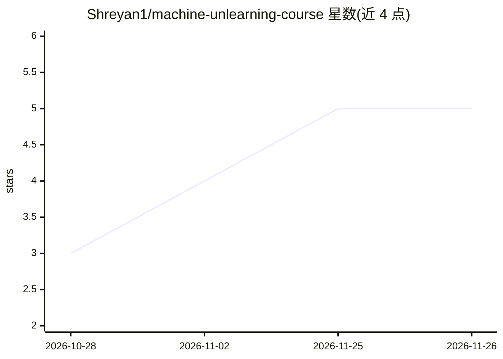

# Shreyan1/machine-unlearning-course

⭐ 5 · Jupyter Notebook · NOASSERTION · 推送 2026-11-11 · [GitHub](https://github.com/Shreyan1/machine-unlearning-course) · [官网](machine-unlearning.shreyanbasuray.com) · 个人维护

**机器遗忘实践课程：让 ML 模型与 LLM 遗忘数据并给出证明**

面向 Responsible AI 的 24 本 notebook、45 道练习题的机器遗忘实践课程，覆盖从 NumPy 手写神经网络到 LLM 的遗忘方法，围绕

## 筛选速览

| 维度 | 判定 | 备注 |
|---|---|---|
| AI 角色 | `ai-knowledge` | 知识聚合/清单类 |
| 许可风险 | `none` | NOASSERTION |
| 部署形态 | `library` | 以包/库形式分发 |
| 模型依赖 | — | README 未给出锁定关系 |
| 硬件要求 | `cpu-ok` | |
| 安装摩擦 | `low` | 无编译、无系统依赖或容器化 |
| 成熟度 | — | 结构信号不足 |

## 能力要点

- 24 个 notebook、45 道练习，从经典 ML 到 LLM 遗忘方法
- 纯 NumPy 实现神经网络，无需深度学习框架，CPU 即可运行
- 统一五步流程：训练→展示记忆→遗忘→验证→对照从未见过数据的模型证明
- 按身份提供六条学习路径（隐私/法律人员、ML 研究者、LLM 工程师等）

## 适用场景

- 处理用户数据删除请求（GDPR 被遗忘权）时评估遗忘方法是否真的删除了影响
- 审计供应商或团队的机器遗忘声明
- 学习 SISA、LoRA、成员推断攻击等遗忘与验证技术

## 场景标签

`教程课程` `微调` · 领域:学习与行业

## 证据(README 行号)

> L3: **A hands-on course on making a trained model forget someone's data, and testing whether it really did.**
> L8: 24 notebooks
> L107: ### 🧭 Pick your path

## 星数曲线

2026-10-28 3 → 2026-11-26 5（+2）

---
*卡片 v1 · prompt 1.4 · 生成 2026-11-21 · 置信度 mid · 依据 README sha `f38ffe82a6ca` · [字段定义](../../DATASET.md)*
