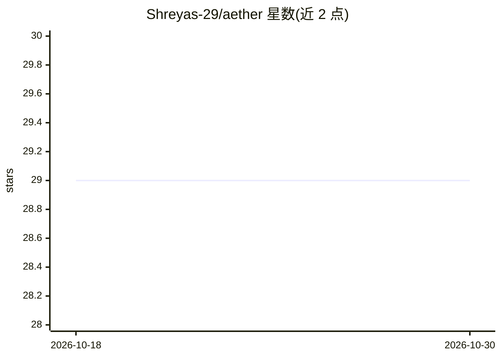

# Shreyas-29/aether

⭐ 29 · TypeScript · 推送 2025-12-26 · [GitHub](https://github.com/Shreyas-29/aether) · [官网](https://aether-ai-chatbot.vercel.app) · 个人维护

**基于 Gemini 的生产力 AI 聊天助手 Web 应用**

Next.js 15 + React 19 构建的网页聊天应用：对话由 Google Gemini 驱动，支持上下文感知对话、聊天历史搜索、Supabase 存储与认证；消息工具包括 Deepgram 语音转文字与文字转语音；可渲染语法高亮代码块、Markdown 表格与图片。功能状态以清单形式标注，流式响应、幻灯片渲染与 Stripe 支付为待实现项。安装方式为 git clone 源码 + pnpm，需自备 Supabase 账户与 Google AI API key，部署面向 Vercel。

## 筛选速览

| 维度 | 判定 | 备注 |
|---|---|---|
| AI 角色 | `ai-native` | 本体是模型或模型工具 |
| 许可风险 | `none` | — |
| 部署形态 | `library` | 以包/库形式分发 |
| 模型依赖 | — | README 未给出锁定关系 |
| 硬件要求 | — | 无带数字的原话,不猜 |
| 安装摩擦 | `low` | 无编译、无系统依赖或容器化 |
| 成熟度 | — | 结构信号不足 |

## 能力要点

- Google Gemini 驱动的上下文感知对话
- Deepgram 提供语音转文字，另含文字转语音
- Supabase 聊天历史保存、搜索与认证
- 渲染语法高亮代码块、Markdown 表格与图片

## 适用场景

- 在网页上与 Gemini 对话并管理历史记录
- 用语音向 AI 助手提问
- 在对话中查看可复制的代码块与表格

## 场景标签

`AI 助手` `聊天机器人` · 领域:对话与助手

## 证据(README 行号)

> L5: Aether is your **AI-powered productivity hub**.
> L13: - Context-aware AI conversations powered by Google Gemini
> L48: - **AI**: Google's Generative AI, Deepgram (for voice)

## 星数曲线

2026-10-18 29 → 2026-10-30 29（+0）

---
*卡片 v1 · prompt 1.4 · 生成 2026-10-26 · 置信度 high · 依据 README sha `ac1c79a389f2` · [字段定义](../../DATASET.md)*
