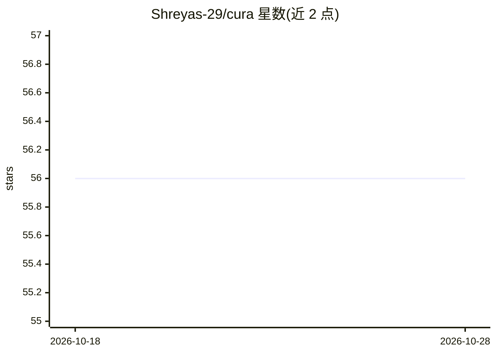

# Shreyas-29/cura

⭐ 56 · TypeScript · MIT · 推送 2026-01-27 · [GitHub](https://github.com/Shreyas-29/cura) · [官网](https://cura.heyshreyas.com) · 个人维护

**个人 AI 健康助手：症状/用药追踪加 AI 聊天**

基于 Next.js 的健康助手 Web 应用，面向个人用户，功能包括症状、用药与健康的集中追踪，以及通过 Gemini API 驱动的 AI 聊天提供健康问答。技术栈使用 Clerk 认证、Stripe 支付（$9 一次性解锁高级功能）、Prisma 与 MongoDB。安装方式为克隆仓库、pnpm 安装依赖、配置 .env 环境变量、推送 Prisma schema 后运行开发服务器。

## 筛选速览

| 维度 | 判定 | 备注 |
|---|---|---|
| AI 角色 | `ai-native` | 本体是模型或模型工具 |
| 许可风险 | `permissive` | MIT |
| 部署形态 | `library` | 以包/库形式分发 |
| 模型依赖 | — | README 未给出锁定关系 |
| 硬件要求 | — | 无带数字的原话,不猜 |
| 安装摩擦 | `low` | 无编译、无系统依赖或容器化 |
| 成熟度 | — | 结构信号不足 |

## 能力要点

- 症状、用药与健康的集中追踪
- Gemini API 驱动的 AI 聊天问答
- Stripe 一次性 $9 解锁高级功能
- Clerk 认证 + Prisma/MongoDB 技术栈

## 适用场景

- 在一个应用中记录症状和用药情况
- 向 AI 助手询问健康相关问题
- 付费解锁额外工具功能

## 场景标签

`AI 助手` · 领域:对话与助手

## 证据(README 行号)

> L13: - **AI-Powered Chat:** Get instant answers and health tips from your AI assistant.
> L36: * Gemini API

## 星数曲线

2026-10-18 56 → 2026-10-28 56（+0）

---
*卡片 v1 · prompt 1.4 · 生成 2026-10-24 · 置信度 low · 依据 README sha `9b48ba199ee0` · [字段定义](../../DATASET.md)*
