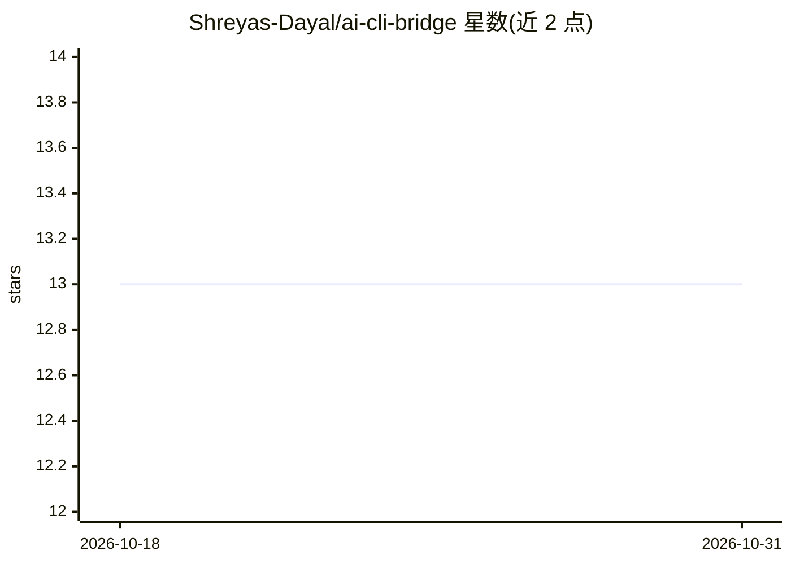

# Shreyas-Dayal/ai-cli-bridge

⭐ 13 · TypeScript · MIT · 推送 2026-05-03 · [GitHub](https://github.com/Shreyas-Dayal/ai-cli-bridge) · 个人维护

**将 Claude Code / Codex CLI 订阅封装为带鉴权的 HTTP API 桥接服务**

基于 Express + Bun 的自托管桥接服务：把 Claude Code CLI 与 OpenAI Codex CLI 包装为 REST API（/generate 与 /generate-codex），支持 SSE 流式输出，让已有 Max/Pro 订阅可被 Web 应用等 HTTP 客户端调用。提供 SHA-256 哈希的每用户 API key、timing-safe 认证、按 key 的请求/Token/费用限额、用量与请求日志、管理面板，支持 Docker 与 systemd 部署。README 声明此用法可能违反 Anthropic 与 OpenAI 服务条款，仅供教育实验用途。

## 筛选速览

| 维度 | 判定 | 备注 |
|---|---|---|
| AI 角色 | `ai-ecosystem` | LLM/agent 周边工具 |
| 许可风险 | `permissive` | MIT |
| 部署形态 | `self-host` | docker 或自建部署 |
| 模型依赖 | — | README 未给出锁定关系 |
| 硬件要求 | — | 无带数字的原话,不猜 |
| 安装摩擦 | `low` | 无编译、无系统依赖或容器化 |
| 成熟度 | — | 结构信号不足 |

## 能力要点

- 两个生成端点分别对接 Claude Code CLI 与 Codex CLI，支持 SSE 流式
- SHA-256 哈希 API key 与 timing-safe 认证、execFile 防 shell 注入
- 每 key 五维限额（请求/Token/费用，按日与月）及用量追踪、管理面板
- Docker、systemd、Cloudflare Tunnel 部署支持

## 适用场景

- 用已有订阅替代按 Token 计费的官方 SDK 调用
- 为多个项目/用户分发带限额的统一 AI 接口
- 通过管理面板监控请求日志与成本

## 场景标签

`模型网关` · 领域:Agent 开发

## 证据(README 行号)

> L5: This server wraps the Claude Code CLI and Codex CLI behind an Express API. Instead of paying per-token, requests are
> L20: - **Two providers** — Claude Code CLI (`/generate`) and Codex CLI (`/generate-codex`)

## 星数曲线

2026-10-18 13 → 2026-10-31 13（+0）

---
*卡片 v1 · prompt 1.4 · 生成 2026-10-31 · 置信度 high · 依据 README sha `7ff87cfa18f3` · [字段定义](../../DATASET.md)*
