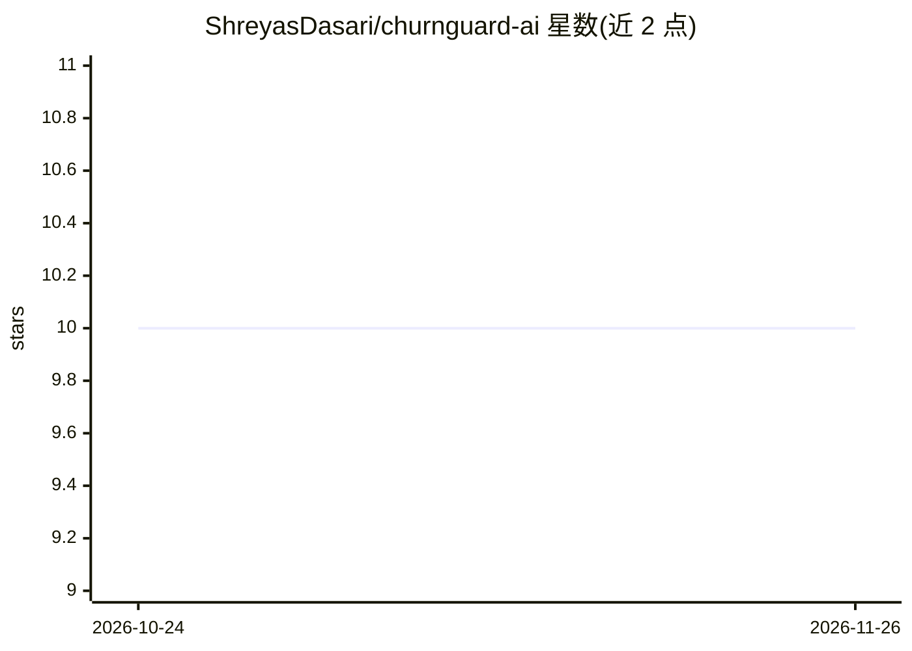

# ShreyasDasari/churnguard-ai

⭐ 10 · Jupyter Notebook · 推送 2026-06-19 · [GitHub](https://github.com/ShreyasDasari/churnguard-ai) · [官网](https://www.churnguard-ai.xyz/) · 个人维护

**为 SaaS 提供开源客户流失预测与预警**

以 Jupyter notebook 形式交付的流失预测工具：从 Stripe、PostHog、HubSpot API 或通用 CSV 读取订阅、支付与使用数据，统一转换为内部四文件 CSV 架构，组合 8 个信号（使用趋势、沉默天数、支付失败、功能采用、合同类型、工单激增、席位利用率等）加权预测流失风险，侧重 30-90 天领先指标并输出干预建议。以 Google Colab 或本地 JupyterLab 运行，Stripe 连接器为只读，也可完全脱离 API 用手动导出的 CSV 运行。

## 筛选速览

| 维度 | 判定 | 备注 |
|---|---|---|
| AI 角色 | `ai-native` | 本体是模型或模型工具 |
| 许可风险 | `none` | — |
| 部署形态 | `None` |  |
| 模型依赖 | — | README 未给出锁定关系 |
| 硬件要求 | — | 无带数字的原话,不猜 |
| 安装摩擦 | `low` | 无编译、无系统依赖或容器化 |
| 成熟度 | — | 结构信号不足 |

## 能力要点

- 读取 Stripe/PostHog/HubSpot API 或通用 CSV，统一为内部 CSV 架构
- 组合 8 个加权信号预测流失，区分 30-90 天领先与滞后指标
- 提供 SHAP 解释与 LLM 干预计划
- Stripe 连接器只读，支持无 API key 的手动 CSV 导出路径

## 适用场景

- 预测哪些 SaaS 客户可能在 30-90 天内取消订阅
- 监控支付失败等非自愿流失信号并触发挽回邮件
- 在流失发生前按领先指标安排客户成功干预

## 场景标签

`数据分析` · 领域:效率与自动化

## 证据(README 行号)

> L3: **Free, open-source churn prediction for SaaS -- plug in your data and know who's leaving before they do**
> L22: |**Data source**|SaaS-native (Stripe, PostHog, HubSpot, CSV)|Enterprise CRM|SaaS CRM|Telecom CSV only|
> L116: ChurnGuard does not produce a single "churn score" in isolation. It combines eight signals that each predict cance

## 星数曲线

2026-10-24 10 → 2026-11-26 10（+0）

---
*卡片 v1 · prompt 1.4 · 生成 2026-11-20 · 置信度 high · 依据 README sha `6010ae2e98f5` · [字段定义](../../DATASET.md)*
