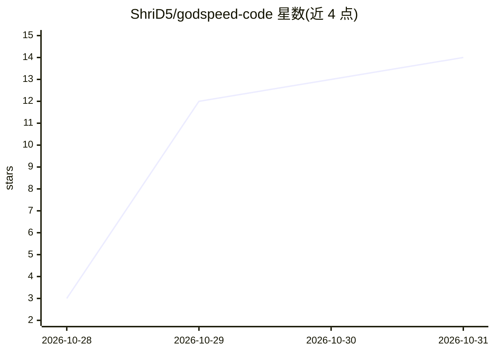

# ShriD5/godspeed-code

⭐ 14 · Rust · MIT · 推送 2026-10-30 · [GitHub](https://github.com/ShriD5/godspeed-code) · [官网](https://godspeed-code.pages.dev) · 个人维护

**统一运行多种 AI 编码 agent CLI 的原生 macOS 桌面应用**

用 Rust + GPUI 构建的桌面应用，把用户已安装的编码 agent CLI（Claude Code、Codex、Cursor、Grok Build、OpenCode 等 10 种）通过各自协议（stream-json、JSON-RPC、ACP、HTTP+SSE 等）纳入统一界面运行。聊天记录本地存储并索引可搜索，支持定时/webhook/文件触发运行 agent、Git 操作、每轮回执（时间/工具/文件/tokens/费用）、用量限制跟踪与跨设备 Mission Control。本身不转售模型访问，用户以各 agent 自己的 CLI 登录。仅支持 Apple silicon macOS，为 Zeron 的 fork；iOS 版处于 TestFlight 公测。

## 筛选速览

| 维度 | 判定 | 备注 |
|---|---|---|
| AI 角色 | `ai-ecosystem` | LLM/agent 周边工具 |
| 许可风险 | `permissive` | MIT |
| 部署形态 | `desktop` | 安装包/桌面程序 |
| 模型依赖 | — | README 未给出锁定关系 |
| 硬件要求 | — | 无带数字的原话,不猜 |
| 安装摩擦 | `low` | 无编译、无系统依赖或容器化 |
| 成熟度 | `idea` | |

## 能力要点

- 通过各自协议驱动 10 种编码 agent CLI 统一运行
- 本地存储与索引搜索全部聊天记录，支持从 T3 Code/Claude Code/Codex/Cursor 导入
- Zoomies：按 cron/webhook/文件触发运行 agent，含记忆文件与结果收件箱
- 每轮回执与按账号的用量限额跟踪、自动恢复

## 适用场景

- 在同一桌面应用里管理多个 AI 编码 agent 的会话与审批
- 定时或按触发条件让 agent 持续执行任务并收集结果
- 跟踪各账号 token 用量与费用，限额重置后自动恢复

## 场景标签

`编码 Agent` · 领域:编码与开发

## 证据(README 行号)

> L19: Godspeed Code (Godspeed for short) runs the coding-agent CLIs you already have (Claude Code, Codex, Cursor and more
> L20: GPU-rendered desktop app. It drives each agent over its own protocol, keeps every chat in a local
> L90: |Agent|How Godspeed drives it|Access modes|

## 星数曲线

2026-10-28 3 → 2026-10-31 14（+11）

---
*卡片 v1 · prompt 1.4 · 生成 2026-10-31 · 置信度 high · 依据 README sha `55d7fb911eba` · [字段定义](../../DATASET.md)*
