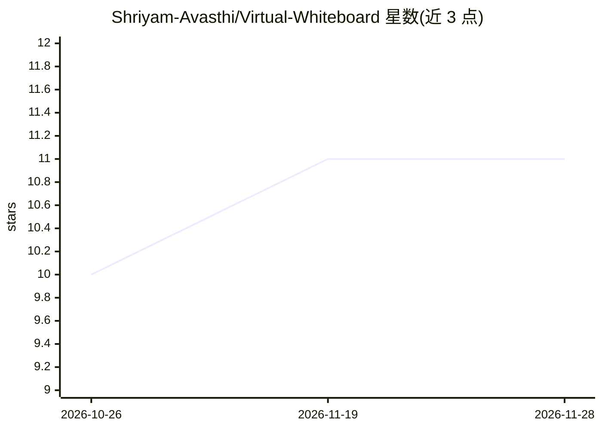

# Shriyam-Avasthi/Virtual-Whiteboard

⭐ 11 · Python · MIT · 推送 2026-02-26 · [GitHub](https://github.com/Shriyam-Avasthi/Virtual-Whiteboard) · 个人维护

**用手势在摄像头视频上作画并可经 OBS 广播的工具**

Python 程序，读取摄像头实时画面，用 mediapipe 检测和跟踪手部关键点，以多种手势（食指拖动作画、双指移动/点击模拟鼠标、拇指平移调笔刷大小、握拳滚动画布）在虚拟画板上书写。输出可经 OBS Studio 虚拟摄像头广播给其他软件；不广播时仅需 Python 环境。安装为克隆仓库并按 requirements.txt 安装指定版本依赖，运行入口为 GUI.py。

## 筛选速览

| 维度 | 判定 | 备注 |
|---|---|---|
| AI 角色 | `ai-native` | 本体是模型或模型工具 |
| 许可风险 | `permissive` | MIT |
| 部署形态 | `library` | 以包/库形式分发 |
| 模型依赖 | — | README 未给出锁定关系 |
| 硬件要求 | — | 无带数字的原话,不猜 |
| 安装摩擦 | `low` | 无编译、无系统依赖或容器化 |
| 成熟度 | — | 结构信号不足 |

## 能力要点

- mediapipe 检测并跟踪手部关键点
- 6 种手势：绘制、鼠标移动、点击、调笔刷大小、滚动画布
- 经 OBS 虚拟摄像头将画面广播到其他软件
- 提供 GUI 入口与演示 GIF/视频

## 适用场景

- 在线教学/录屏时在摄像头画面上手写标注
- 把手势绘制画面作为虚拟摄像头输入给会议或直播软件

## 场景标签

`图像视频处理` `目标检测` · 领域:感知与多模态

## 证据(README 行号)

> L3: A Python program to draw on live video captured from the webcam(or any other camera) using hand gestures and broadca
> L10: 1. Clone the repository to the desired path.
> L13:  `pip install -r /path/to/requirements.txt`

## 星数曲线

2026-10-26 10 → 2026-11-28 11（+1）

---
*卡片 v1 · prompt 1.4 · 生成 2026-11-19 · 置信度 high · 依据 README sha `0b040e004a9c` · [字段定义](../../DATASET.md)*
