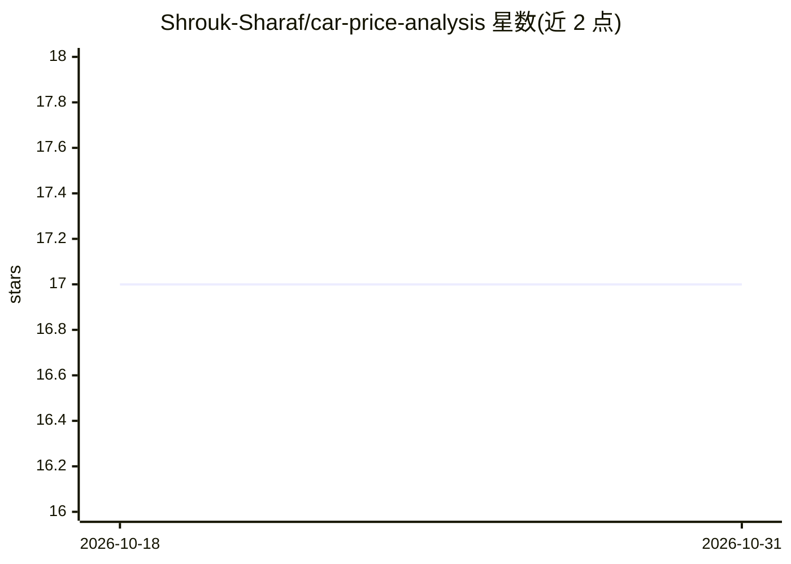

# Shrouk-Sharaf/car-price-analysis

⭐ 17 · Jupyter Notebook · 推送 2026-01-30 · [GitHub](https://github.com/Shrouk-Sharaf/car-price-analysis) · 个人维护

**11,914 辆车的价格探索性分析与市场细分项目**

基于 Python/Pandas/NumPy 的汽车行业探索性数据分析项目，分析 11,914 辆车数据，进行特征工程、数据清洗与相关性统计建模（HP 与价格相关系数 0.7），识别主流与豪华两极分化的市场结构，并用 Power BI、Matplotlib、Seaborn 构建交互式可视化仪表板，输出营销细分与产品策略建议。作为 Samsung Innovation Campus AI Track 的课程项目完成，通过 Jupyter Notebook 运行。

## 筛选速览

| 维度 | 判定 | 备注 |
|---|---|---|
| AI 角色 | `ai-native` | 本体是模型或模型工具 |
| 许可风险 | `none` | — |
| 部署形态 | `library` | 以包/库形式分发 |
| 模型依赖 | — | README 未给出锁定关系 |
| 硬件要求 | — | 无带数字的原话,不猜 |
| 安装摩擦 | `low` | 无编译、无系统依赖或容器化 |
| 成熟度 | — | 结构信号不足 |

## 能力要点

- 11,914 辆车数据的清洗与特征工程
- 相关性分析：发动机 HP 与价格 r=0.7，缸数 r=0.5
- 主流与豪华品牌双峰市场结构识别
- Power BI 交互式商业智能仪表板

## 适用场景

- 分析汽车价格的关键技术与品牌驱动因素
- 为营销细分和产品策略提供数据支撑
- 作为 EDA 与 Power BI 可视化的学习参考项目

## 场景标签

`数据分析` · 领域:效率与自动化

## 证据(README 行号)

> L9: - Identified strong correlation between engine performance (HP, cylinders) and price (r=0.7)
> L22: 2. **Price Drivers:** Engine HP (0.7 correlation) and cylinder count (0.5 correlation) are strongest technical pric

## 星数曲线

2026-10-18 17 → 2026-10-31 17（+0）

---
*卡片 v1 · prompt 1.4 · 生成 2026-10-29 · 置信度 mid · 依据 README sha `93a34366d6fb` · [字段定义](../../DATASET.md)*
