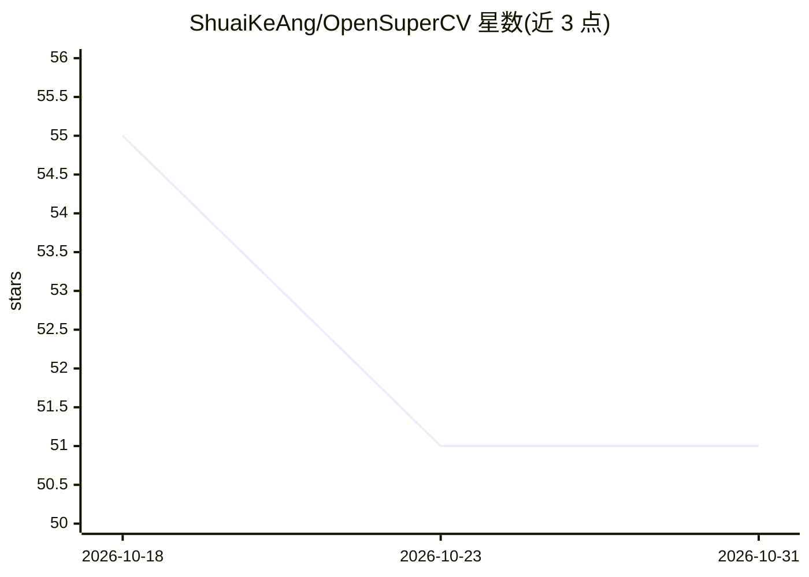

# ShuaiKeAng/OpenSuperCV

⭐ 51 · C# · MIT · 推送 2026-09-13 · [GitHub](https://github.com/ShuaiKeAng/OpenSuperCV) · 个人维护 · 中文 README

**Windows 桌面 AI 剪贴板：自动收集、检索并在旁处理复制内容**

WPF 桌面剪贴板工具，面向 Windows 10/11 用户：自动收集任意应用复制的文字与图片到轻量工作区，支持工作区隔离、书签、置顶、颜色标记、关键词与 AI 模糊搜索，通过单击、拖放或全局快捷键（可接管 Win+V）粘贴回目标应用。AI 为可选功能：连接各模型厂商服务后可在条目上执行翻译、摘要、润色与自定义指令，工作区 Agent 支持只读/审核批准/完全访问三档权限调用工具整理内容；不启用 AI 时剪贴板功能完整可用。从 Releases 下载安装。

## 筛选速览

| 维度 | 判定 | 备注 |
|---|---|---|
| AI 角色 | `ai-enhanced` | 去掉 AI 部分产品仍成立 |
| 许可风险 | `permissive` | MIT |
| 部署形态 | `None` |  |
| 模型依赖 | — | README 未给出锁定关系 |
| 硬件要求 | — | 无带数字的原话,不猜 |
| 安装摩擦 | `low` | 无编译、无系统依赖或容器化 |
| 成熟度 | — | 结构信号不足 |

## 能力要点

- 工作区/书签/置顶/颜色标记多层内容组织与关键词检索
- 条目级 AI 指令（翻译、摘要、润色、自定义提示词）
- 工作区 Agent 带只读/审核批准/完全访问三档权限，可调用工具执行筛选、编辑等任务
- `/fs` AI 语义模糊搜索；不启用 AI 时剪贴板功能完整可用

## 适用场景

- 跨应用收集资料、代码片段和命令，按项目隔离管理
- 用 AI 在剪贴板条目上直接翻译、总结、润色或整理为待办清单
- 通过全局快捷键或接管 Win+V 快速复用高频内容
- 让 Agent 在权限控制下归纳和整理工作区内容

## 场景标签

`AI 助手` `知识库管理` · 领域:对话与助手

## 证据(README 行号)

> L148: - **AI 完全可选**：不启用 AI，也可以使用完整的剪贴板收集、整理、检索与复用能力。
> L79: 它最强的功能AI————可以完全关闭！

## 星数曲线

2026-10-18 55 → 2026-10-31 51（-4）

---
*卡片 v1 · prompt 1.4 · 生成 2026-10-24 · 置信度 high · 依据 README sha `dbb07553b25d` · [字段定义](../../DATASET.md)*
