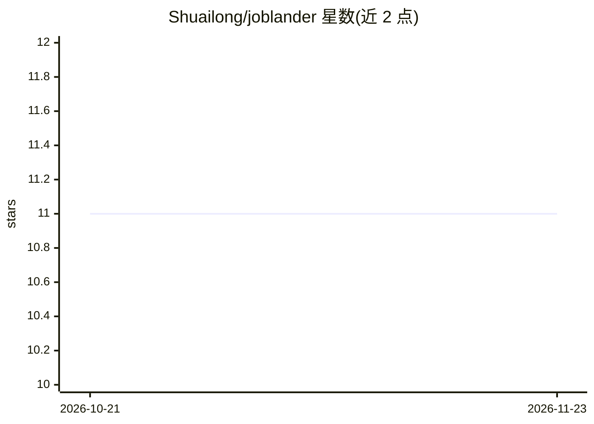

# Shuailong/joblander

⭐ 11 · Python · Apache-2.0 · 推送 2026-10-14 · [GitHub](https://github.com/Shuailong/joblander) · [官网](https://ailayoff.me) · 个人维护 · 中文 README

**给求职者的多 Agent 引擎：搜索、跟进与简历定制带人工审批**

围绕求职全流程的多 Agent 引擎：职位扫描打分、公司尽调（多轮 ReAct 搜索）、JD 匹配分析、薪酬报告、简历定制（单次生成 + layout-as-code 渲染）。每个对外动作都经提案队列人工审批，Event Log 为唯一事实源，评估采用独立模型档位 + 盲审 + 零 LLM 硬校验。需要 Python 3.10+ 与 OpenAI 或 Gemini API key，可选 Notion/Gmail/Tavily 集成；另有邀请制托管版。文档与提示词以中文为主。

## 筛选速览

| 维度 | 判定 | 备注 |
|---|---|---|
| AI 角色 | `ai-native` | 本体是模型或模型工具 |
| 许可风险 | `permissive` | Apache-2.0 |
| 部署形态 | `None` |  |
| 模型依赖 | — | README 未给出锁定关系 |
| 硬件要求 | — | 无带数字的原话,不猜 |
| 安装摩擦 | `low` | 无编译、无系统依赖或容器化 |
| 成熟度 | `idea` | |

## 能力要点

- 所有对外动作经提案队列人工审批，Agent 不直接触达外部
- 多轮 ReAct 尽调、单次生成简历等按实验证据选择循环模式
- 评估用独立模型档位盲审 + 随机映射 + 零 LLM 硬校验
- 数据存于 gitignore 的私有 workspace_dir，不入仓库

## 适用场景

- 集中管理职位投递、面试跟进与公司调研
- 自动定制简历并保留每版可追溯的反馈积累
- offer 量化比较：按私有的折扣参数解释性排序
- 求职期间保留 AI 产出与人工记录的时间线区分

## 场景标签

`多智能体` `AI 写作` · 领域:Agent 开发

## 证据(README 行号)

> L5: > A multi-agent engine for running a job search — with guardrails, human approval gates, and an eval harness.
> L43: Requires Python 3.10+ and an LLM API key (OpenAI or Gemini). Verified on 3.11 and 3.14, editable and regular instal
> L141: |**Diligence**|Zero-input company research: highlight card + four-section profile (every claim carries a numbered 

## 星数曲线

2026-10-21 11 → 2026-11-23 11（+0）

---
*卡片 v1 · prompt 1.4 · 生成 2026-11-18 · 置信度 high · 依据 README sha `3263e51b830d` · [字段定义](../../DATASET.md)*
