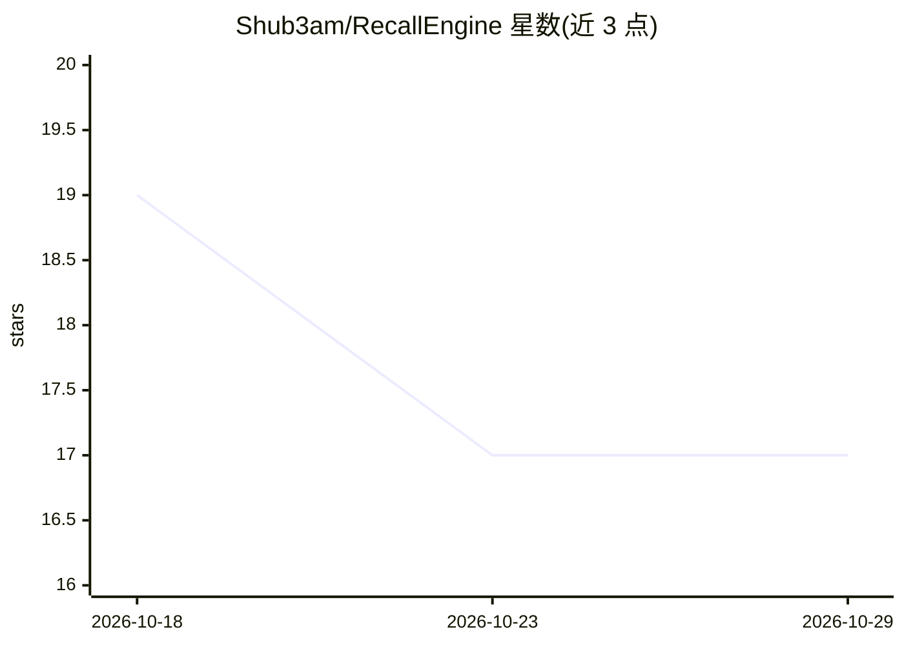

# Shub3am/RecallEngine

⭐ 17 · Python · 推送 2026-10-06 · [GitHub](https://github.com/Shub3am/RecallEngine) · 个人维护

**面向文件与数据库的搜索与带引用 RAG 库**

RecallEngine 是一个 Python 库，同时提供 CLI 与 FastAPI HTTP API：指向文件夹、单文件、SQLite 或 SQLAlchemy 数据库 URL 即可索引搜索，支持关键词、布尔、BM25、TF-IDF、语义与混合（RRF 融合）六种模式；文档被切分为带稳定 passage_id 的重叠片段，索引与嵌入缓存于磁盘。RAG 方面通过 retrieve 为任意模型提供片段，ask 命令调用 Claude 生成带编号引用的回答（需 rag 扩展与 ANTHROPIC_API_KEY）。核心依赖轻量，PDF 解析、嵌入、数据库、服务端与 Claude 均为可选扩展；提供 Docker 镜像（linux/amd64 与 arm64）。

## 筛选速览

| 维度 | 判定 | 备注 |
|---|---|---|
| AI 角色 | `ai-ecosystem` | LLM/agent 周边工具 |
| 许可风险 | `none` | — |
| 部署形态 | `self-host` | docker 或自建部署 |
| 模型依赖 | locked-api |  |
| 硬件要求 | — | 无带数字的原话,不猜 |
| 安装摩擦 | `low` | 无编译、无系统依赖或容器化 |
| 成熟度 | — | 结构信号不足 |

## 能力要点

- 六种搜索模式与 Reciprocal Rank Fusion 混合排序
- 多源（文件夹/文件/SQLite/SQLAlchemy URL）一次构建保存索引，嵌入缓存复用
- ask 由 Claude 从检索片段作答并返回逐条引用（passage_id）
- 同一引擎以库、recall_engine CLI、FastAPI 服务（可选 API key 认证）三种形式使用

## 适用场景

- 给本地文档文件夹或业务数据库建可检索知识库
- 构建带出处引用的问答服务并通过 HTTP API 供其他系统调用
- 为任意 LLM 提供统一的混合检索片段（retrieve）接口

## 场景标签

`RAG` `语义搜索` · 领域:知识与检索

## 证据(README 行号)

> L20: |**RAG building blocks**|Ingest many sources into one saved index, embed it once, and `retrieve` passages for any m
> L21: |**Cited answers**|`ask` retrieves the best passages and has Claude answer from them only, with numbered citations.
> L90: Build a knowledge base from several sources once, then retrieve passages for any model's prompt, or let `ask` hand 

## 星数曲线

2026-10-18 19 → 2026-10-29 17（-2）

---
*卡片 v1 · prompt 1.4 · 生成 2026-10-29 · 置信度 high · 依据 README sha `e29ffa57745b` · [字段定义](../../DATASET.md)*
