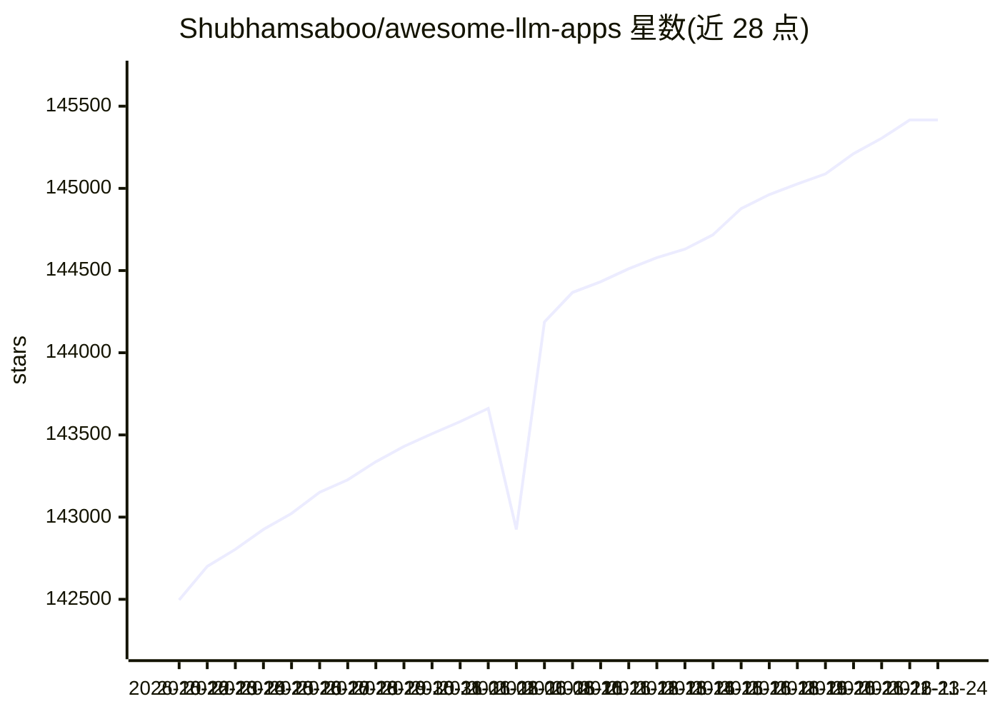

# Shubhamsaboo/awesome-llm-apps

⭐ 145,529 · Python · Apache-2.0 · 推送 2026-11-18 · [GitHub](https://github.com/Shubhamsaboo/awesome-llm-apps) · [官网](https://www.theunwindai.com) · 个人维护

**面向开发者的 100+ 开源 AI Agent 与 RAG 应用模板合集**

收录 100+ 开源 AI agent、agent 技能与 RAG 应用模板，Apache-2.0 许可，按 Agent Skills、Standalone Apps、Starter Agents、Advanced Agents、Multi-agent Teams、Voice、MCP、RAG 等类别组织。每个模板附源码，入门类为单文件、仅需 API key 即可运行；Agent Skills 通过 npx 一条命令安装到 Claude Code、Codex、Cursor 等编码 agent，并通过安全与 eval CI 检查。

## 筛选速览

| 维度 | 判定 | 备注 |
|---|---|---|
| AI 角色 | `ai-knowledge` | 知识聚合/清单类 |
| 许可风险 | `permissive` | Apache-2.0 |
| 部署形态 | `library` | 以包/库形式分发 |
| 模型依赖 | — | README 未给出锁定关系 |
| 硬件要求 | — | 无带数字的原话,不猜 |
| 安装摩擦 | `low` | 无编译、无系统依赖或容器化 |
| 成熟度 | — | 结构信号不足 |

## 动量与使用信号

- 维护:`active` — 距上次 push 0.6 天,年发版 0,106 位贡献者
- 涨星:近 1 天 **+167**(自 20261016 起算)
- 安装:npm 包 `skills` 月下载 23,786,800
- 平台:— · 协议:MCP

## 能力要点

- 100+ 模板按技能/入门/进阶/多智能体/语音/MCP/RAG 等类别组织
- Agent Skills 支持 npx 一条命令安装到 Claude Code、Codex、Cursor 等编码 agent
- 入门 agent 为单文件、仅需一个 API key 即可运行
- Apache-2.0 许可，允许克隆与商用

## 适用场景

- 为学习或原型开发挑选可运行的 agent 模板
- 给编码 agent 安装现成技能提升工作流
- 基于模板快速搭建 RAG 或多智能体应用

## 场景标签

`多智能体` `RAG` `精选清单` · 领域:Agent 开发

## 证据(README 行号)

> L1: # Awesome LLM Apps
> L56: ### 🧩 Agent Skills
> L3: **100+ open-source AI agents, agent skills, and RAG apps. Hand-built, tested end-to-end, Apache-2.0.**

## 星数曲线

2026-10-22 142,496 → 2026-11-24 145,416（+2,920）

---
*卡片 v1 · prompt 1.4 · 生成 2026-11-22 · 置信度 high · 依据 README sha `daa931912b72` · [字段定义](../../DATASET.md)*
