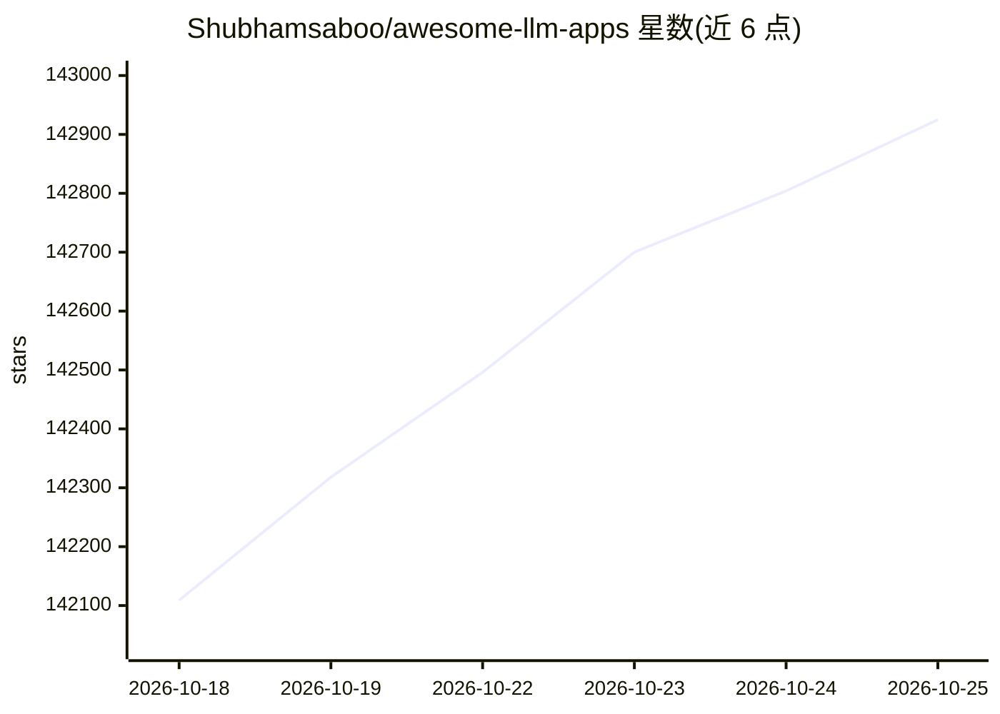

# Shubhamsaboo/awesome-llm-apps

⭐ 142,925 · Python · Apache-2.0 · 推送 2026-10-22 · [GitHub](https://github.com/Shubhamsaboo/awesome-llm-apps) · [官网](https://www.theunwindai.com) · 个人维护

**面向开发者的 100+ 开源 AI agent 与 RAG 应用模板合集**

以 Apache-2.0 许可的开源仓库形式收录 100+ 模板，按 Agent Skills、入门/进阶 agent、多 agent 团队、语音 agent、生成式 UI、游戏 agent、MCP agent 与 RAG 等类别组织；每个模板附带可运行代码，可通过 npx 安装技能或 git clone 后 pip 安装依赖并用 streamlit 运行。支持接入 Claude、Gemini、GPT、DeepSeek、Llama、Qwen 等模型，入门类 agent 只需 API key 即可运行。模板通过 Unwind AI 周更分发。

## 筛选速览

| 维度 | 判定 | 备注 |
|---|---|---|
| AI 角色 | `ai-ecosystem` | LLM/agent 周边工具 |
| 许可风险 | `permissive` | Apache-2.0 |
| 部署形态 | `library` | 以包/库形式分发 |
| 模型依赖 | — | README 未给出锁定关系 |
| 硬件要求 | — | 无带数字的原话,不猜 |
| 安装摩擦 | `low` | 无编译、无系统依赖或容器化 |
| 成熟度 | — | 结构信号不足 |

## 动量与使用信号

- 维护:`active` — 距上次 push 0.6 天,年发版 0,106 位贡献者
- 涨星:近 1 天 **+167**(自 20261016 起算)
- 安装:npm 包 `skills` 月下载 23,786,800
- 平台:— · 协议:MCP

## 能力要点

- 100+ 开源模板，覆盖入门 agent、多 agent 团队、MCP、RAG 等类别
- Agent Skills 可通过 npx 一条命令安装，适配 Claude Code、Codex、Cursor 等编码 agent
- 入门类单文件 agent 仅需 API key 即可运行
- 支持本地与云端模型（含本地 RAG 与本地旅行 agent）

## 适用场景

- 找一个可克隆运行的 agent 模板学习 agent 开发
- 给编码 agent 安装现成技能扩展能力
- 基于 RAG 或多 agent 模板搭建自己的应用原型

## 场景标签

`多智能体` `RAG` `精选清单` · 领域:Agent 开发

## 证据(README 行号)

> L3: **100+ open-source AI agents, agent skills, and RAG apps. Hand-built, tested end-to-end, Apache-2.0.**
> L7: Works with Claude, Gemini, GPT, DeepSeek, Llama, Qwen and other open-source models.
> L56: ### 🧩 Agent Skills

## 星数曲线

2026-10-18 142,109 → 2026-10-25 142,925（+816）

---
*卡片 v1 · prompt 1.4 · 生成 2026-10-18 · 置信度 mid · 依据 README sha `2c10cb3c7142` · [字段定义](../../DATASET.md)*
