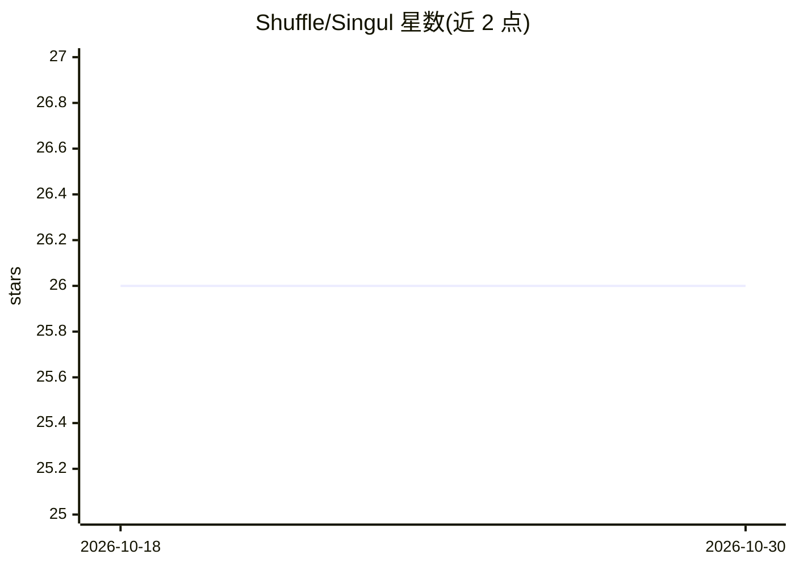

# Shuffle/Singul

⭐ 26 · Go · AGPL-3.0 · 推送 2026-10-26 · [GitHub](https://github.com/Shuffle/Singul) · [官网](https://singul.io) · 组织维护

**一行代码连接各服务的 API 标准化客户端，用 LLM 做请求翻译**

由 Shuffle 团队开源的 API 连接与标准化工具：以统一接口调用 Jira、ServiceNow 等服务，把请求与响应翻译为 OCSF 等标准格式。关键机制是首次成功后存储翻译、复用已知翻译库，并对缺失输入字段报错而非猜测；认证信息本地加密存储。LLM 用于生成翻译，支持 OpenAI 格式及通过环境变量切换 Ollama、Gemini、Anthropic 等提供商。提供 Python 库、CLI 与 singul.io 托管 API 三种用法，本地源码为 Go。

## 筛选速览

| 维度 | 判定 | 备注 |
|---|---|---|
| AI 角色 | `ai-ecosystem` | LLM/agent 周边工具 |
| 许可风险 | `viral` | AGPL-3.0 |
| 部署形态 | `library` | 以包/库形式分发 |
| 模型依赖 | local-ok | 支持本地模型 |
| 硬件要求 | — | 无带数字的原话,不猜 |
| 安装摩擦 | `low` | 无编译、无系统依赖或容器化 |
| 成熟度 | — | 结构信号不足 |

## 能力要点

- 统一接口调用多服务并转换为 OCSF 标准格式
- 翻译持久化与全局翻译库，确定性而非猜测
- 认证信息本地加密存储
- 支持通过环境变量切换多种 OpenAI 兼容 LLM 提供商

## 适用场景

- 用统一格式跨多个 SaaS 服务读写工单等数据
- 为 AI agent 提供确定性的多工具 API 接入层
- 把不同 API 的输出归一化为标准格式做数据处理

## 场景标签

`工作流自动化` · 领域:效率与自动化

## 证据(README 行号)

> L5: Connect to anything with a Singul line of code. Now open source!
> L48: APIs and AI Agents should be easier to use and build. Singul solves both by being easy to use, deterministic and co
> L63: ## LLM Controls

## 星数曲线

2026-10-18 26 → 2026-10-30 26（+0）

---
*卡片 v1 · prompt 1.4 · 生成 2026-10-26 · 置信度 high · 依据 README sha `260854b841ff` · [字段定义](../../DATASET.md)*
