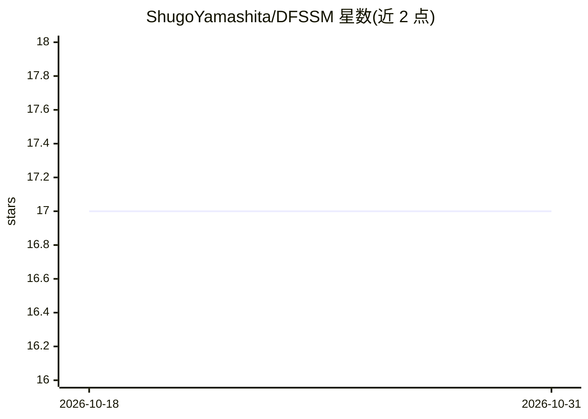

# ShugoYamashita/DFSSM

⭐ 17 · Python · 推送 2025-12-06 · [GitHub](https://github.com/ShugoYamashita/DFSSM) · 个人维护

**ACCV 2024 论文官方代码：频域增强状态空间模型的图像去雨**

论文 "Image Deraining with Frequency-Enhanced State Space Model" 的官方 PyTorch 实现，面向计算机视觉研究者。模型将状态空间模型（SSM）引入图像去雨，结合频域处理去除特定方向的高频雨纹，并提出混合尺度门控卷积块以捕获多尺度退化。基于 BasicSR/Restormer/MambaIR 构建，提供训练与测试脚本，在 Rain200H/L、DID-Data、DDN-Data、SPA-Data、LHP-Rain 六个合成与真实数据集上给出 PSNR/SSIM 结果表。限定测试环境为 CUDA 11.7、Python 3.9、PyTorch 1.13.1。

## 筛选速览

| 维度 | 判定 | 备注 |
|---|---|---|
| AI 角色 | `ai-native` | 本体是模型或模型工具 |
| 许可风险 | `none` | — |
| 部署形态 | `library` | 以包/库形式分发 |
| 模型依赖 | — | README 未给出锁定关系 |
| 硬件要求 | — | 无带数字的原话,不猜 |
| 安装摩擦 | `medium` | 含编译或系统依赖之一 |
| 成熟度 | — | 结构信号不足 |

## 能力要点

- 将 SSM 引入图像去雨，并行进行频域处理
- 混合尺度门控卷积块捕获多尺度退化
- 提供多 GPU 与单 GPU 训练命令及测试脚本
- 六个合成/真实数据集的 PSNR/SSIM 结果表

## 适用场景

- 复现论文的去雨实验结果
- 在自有雨图数据集上训练或微调去雨模型
- 作为 SSM 图像复原研究的参考实现

## 场景标签

`图像视频处理` · 领域:感知与多模态

## 证据(README 行号)

> L1: # DFSSM (ACCV 2024)
> L4: This is the official code of the ACCV 2024 paper Image Deraining with Frequency-Enhanced State Space Model.
> L7: Removing rain degradations in images is recognized as a significant issue. In this field, deep learning-based approa

## 星数曲线

2026-10-18 17 → 2026-10-31 17（+0）

---
*卡片 v1 · prompt 1.4 · 生成 2026-10-29 · 置信度 high · 依据 README sha `b2d36df12312` · [字段定义](../../DATASET.md)*
