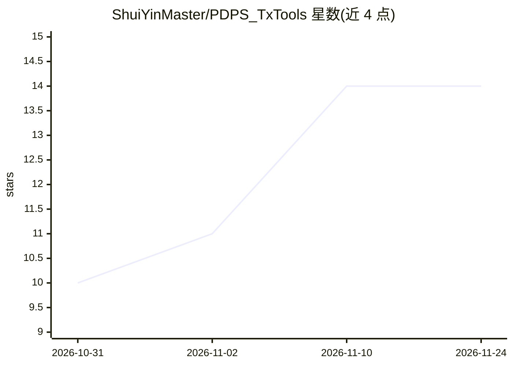

# ShuiYinMaster/PDPS_TxTools

⭐ 14 · C# · MIT · 推送 2026-11-23 · [GitHub](https://github.com/ShuiYinMaster/PDPS_TxTools) · 个人维护 · 中文 README

**给 PDPS 工程师的机器人焊接仿真与离线编程插件集**

面向 Siemens Tecnomatix Process Simulate（PDPS）的 23 个 C# 插件集合，基于 Tecnomatix.Engineering SDK 构建，覆盖焊接路径规划、可达性与干涉检查、焊点编辑分配、几何建模，以及 CATIA/Excel 导出交付。AI 部分：TxAgent 提供进程内场景查询、C#/Python 配方复用与多实例协作，McpBridge 以 stdio 桥接外部 MCP 客户端到指定 PDPS 实例。要求宿主 PS 2402、.NET Framework 4.8 x64，SDK DLL 不随仓库分发，需从源码构建后经 CommandReg 注册。

## 筛选速览

| 维度 | 判定 | 备注 |
|---|---|---|
| AI 角色 | `ai-enhanced` | 去掉 AI 部分产品仍成立 |
| 许可风险 | `permissive` | MIT |
| 部署形态 | `desktop` | 安装包/桌面程序 |
| 模型依赖 | local-ok | 支持本地模型 |
| 硬件要求 | — | 无带数字的原话,不猜 |
| 安装摩擦 | `medium` | 含编译或系统依赖之一 |
| 成熟度 | — | 结构信号不足 |

## 能力要点

- 23 个模块：路径规划（含 RRT）、可达性检查、焊点分配与分组、几何建模、CATIA/Excel 导出
- TxAgent 支持 DeepSeek、Kimi、千问、OpenAI、Ollama 与自定义端点，操作可保存为带执行按钮的 Markdown 配方
- McpBridge 通过 stdio 与命名管道 RPC 将外部 MCP 客户端桥接到目标 PDPS 实例
- 支持撤销的场景写入按批次分组，SDK 调用经主线程封送

## 适用场景

- 为焊接操作生成进出枪点和过渡路径并校验碰撞
- 批量检查机器人焊点可达性与关节限位余量
- 导出焊枪、焊点坐标与 CATIA/Excel 评审交付资料
- 用 AI 查询场景并把验证过的操作保存为可复用配方

## 场景标签

 · 领域:工业制造/机器人仿真

## 证据(README 行号)

> L7: 面向 **Siemens Tecnomatix Process Simulate（PDPS）** 的 C# 插件集合，把焊接路径规划、机器人检查、焊点编辑、几何建模和 CATIA / Excel 交付串成日常工程流程；也可通过 **
> L23: |用 AI 查询场景，把重复操作保存为配方|TxAgent：只读查询 → 核对变更 → 保存配方 → 界面复用|
> L115: |AI 与配方|TxAgent|进程内 AI、场景工具、C# / Python 配方与多实例协作|
> L116: |AI 与配方|McpBridge|外部 MCP 客户端与目标 PDPS 实例之间的 stdio 桥|

## 星数曲线

2026-10-31 10 → 2026-11-24 14（+4）

---
*卡片 v1 · prompt 1.4 · 生成 2026-11-18 · 置信度 high · 依据 README sha `a2d0f1d9ef8e` · [字段定义](../../DATASET.md)*
