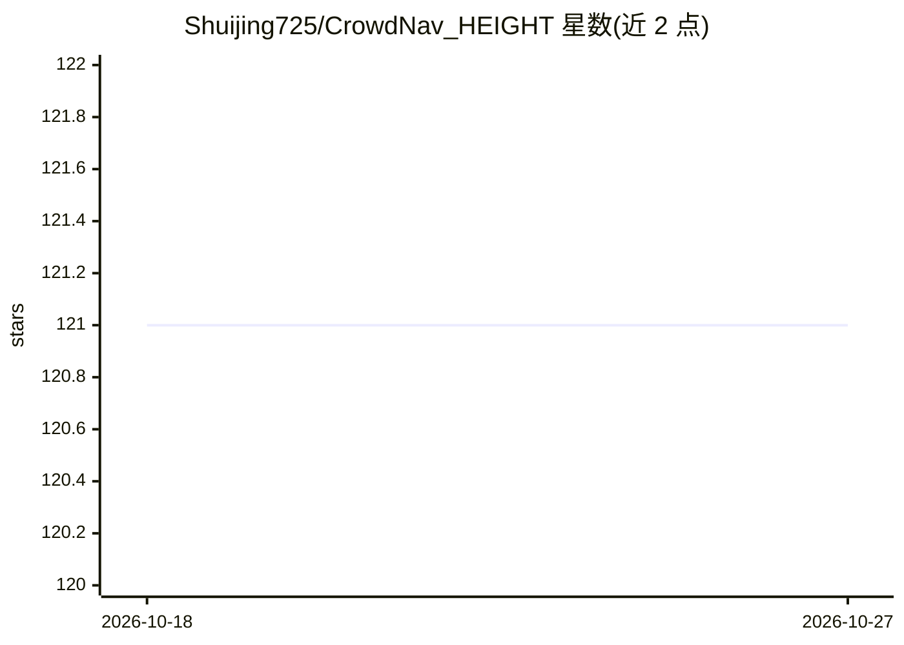

# Shuijing725/CrowdNav_HEIGHT

⭐ 121 · Python · MIT · 推送 2025-12-26 · [GitHub](https://github.com/Shuijing725/CrowdNav_HEIGHT) · [官网](https://sites.google.com/view/crowdnav-height/home) · 组织维护

**拥挤受限环境中机器人导航的深度强化学习策略代码**

T-ASE 论文 HEIGHT 的官方代码：用异构时空图建模人-机器人-障碍物交互，基于注意力机制与循环网络，通过 PPO 深度强化学习训练导航策略，支持走廊、家具等受限场景。仓库含仿真环境 crowd_sim、配置 crowd_nav、训练代码 training 三部分，提供预训练 checkpoint 下载，含仿真训练测试、sim2real 真机部署（Clearpath Jackal、Turtlebot2）及注意力可视化分支。仅在 Ubuntu 20.04 + Python 3.8 测试过，性能随超参数与随机种子波动。

## 筛选速览

| 维度 | 判定 | 备注 |
|---|---|---|
| AI 角色 | `ai-native` | 本体是模型或模型工具 |
| 许可风险 | `permissive` | MIT |
| 部署形态 | `library` | 以包/库形式分发 |
| 模型依赖 | — | README 未给出锁定关系 |
| 硬件要求 | — | 无带数字的原话,不猜 |
| 安装摩擦 | `low` | 无编译、无系统依赖或容器化 |
| 成熟度 | — | 结构信号不足 |

## 能力要点

- 异构时空图 + 注意力机制的导航策略网络 HEIGHT
- PPO 训练，含 DS-RNN、HomoGAT、DRL-VO、ORCA 等基线
- 提供预训练模型 checkpoint 与注意力可视化分支
- sim2real 真机部署支持（Hallway/Lounge/Atrium/Outdoor）

## 适用场景

- 在仿真中训练并评测人群导航避障策略
- 复现论文实验或对比基线方法
- 将训练好的策略迁移到真实机器人部署

## 场景标签

`强化学习` · 领域:训练与推理

## 证据(README 行号)

> L12: In this article, we leverage a graph-based representation of crowded and constrained scenarios and propose a struct
> L15: HEIGHT utilizes attention mechanisms to prioritize important interactions and a recurrent network to track changes 

## 星数曲线

2026-10-18 121 → 2026-10-27 121（+0）

---
*卡片 v1 · prompt 1.4 · 生成 2026-10-23 · 置信度 high · 依据 README sha `98fb09195076` · [字段定义](../../DATASET.md)*
