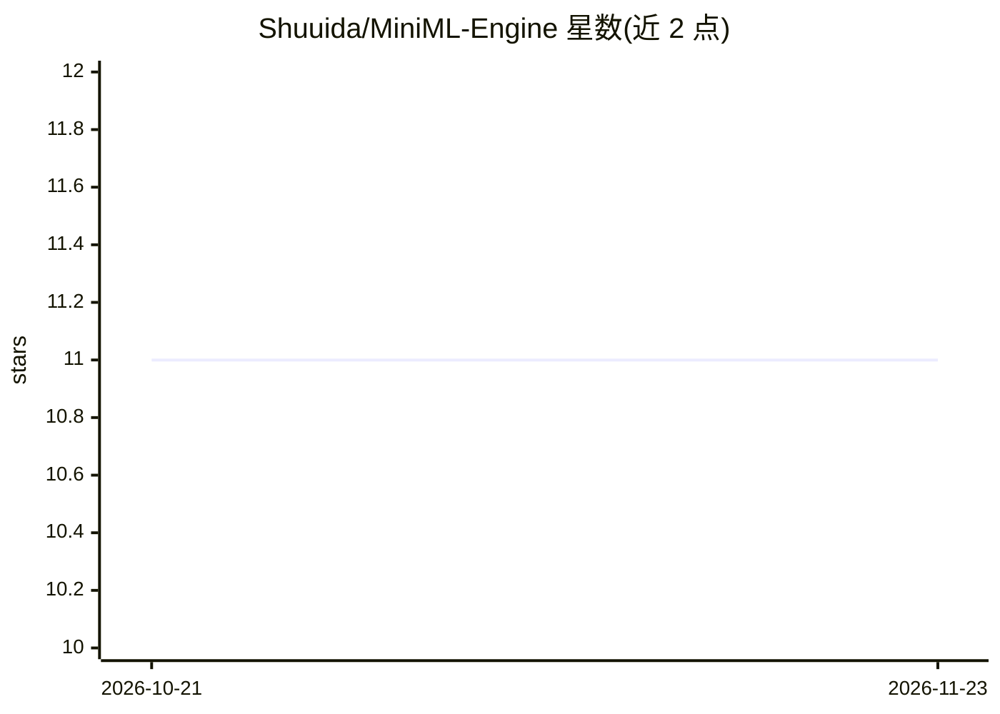

# Shuuida/MiniML-Engine

⭐ 11 · Python · MIT · 推送 2026-06-09 · [GitHub](https://github.com/Shuuida/MiniML-Engine) · [官网](https://github.com/Shuuida) · 个人维护

**面向微控制器的轻量机器学习框架：PC 训练导出 C++ 推理**

纯 Python 实现的机器学习与深度学习框架，无外部依赖，包含传统 ML 引擎（决策树、随机森林、线性模型、SVM、KNN）与 MiniTensor 自动微分深度学习引擎（Conv1D/2D、可分离卷积、残差块等）。模型经 INT8 量化后导出为标准 C99 代码并打包为 PlatformIO/Arduino IDE 库，在低于 2KB SRAM 的微控制器上执行；提供内存估算 CLI 与 sklearn 模型互转导出。

## 筛选速览

| 维度 | 判定 | 备注 |
|---|---|---|
| AI 角色 | `ai-native` | 本体是模型或模型工具 |
| 许可风险 | `permissive` | MIT |
| 部署形态 | `library` | 以包/库形式分发 |
| 模型依赖 | — | README 未给出锁定关系 |
| 硬件要求 | — | 无带数字的原话,不猜 |
| 安装摩擦 | `low` | 无编译、无系统依赖或容器化 |
| 成熟度 | — | 结构信号不足 |

## 能力要点

- 零依赖纯 Python 核心：线性代数、决策树、N 维计算图与反向传播均自实现
- INT8 混合量化，权重以 8 位存储、推理时动态反量化
- 导出原生 C++ 库，双清单文件（library.json / library.properties）适配 PlatformIO 与 Arduino IDE
- 编译前 SRAM/Flash 内存占用估算 CLI

## 适用场景

- 在微控制器上本地检测工业电机振动的异常
- 用低成本传感器（DHT11、LDR）做融合预测，无需联网
- 为热成像或小型光学相机训练低分辨率模式分类器

## 场景标签

`模型量化` `推理引擎` · 领域:训练与推理

## 证据(README 行号)

> L21: **MiniML Engine** is an industrial-grade Machine Learning and Deep Learning framework explicitly designed for **ext
> L23: Defying industry standards, MiniML operates with **zero external dependencies**. No NumPy, no SciPy, no PyTorch, an

## 星数曲线

2026-10-21 11 → 2026-11-23 11（+0）

---
*卡片 v1 · prompt 1.4 · 生成 2026-11-18 · 置信度 high · 依据 README sha `0e39e7662ba3` · [字段定义](../../DATASET.md)*
