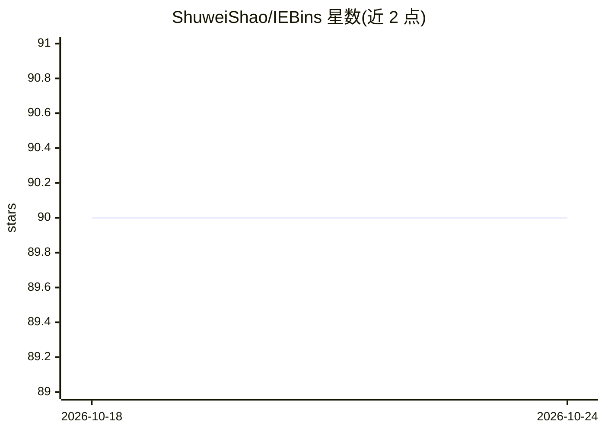

# ShuweiShao/IEBins

⭐ 90 · Python · MIT · 推送 2026-03-24 · [GitHub](https://github.com/ShuweiShao/IEBins) · 组织维护

**单目深度估计模型 IEBins：迭代弹性分箱逐阶段优化深度搜索范围**

NeurIPS 2023 提出的分类-回归式单目深度估计方法：多阶段迭代，每阶段在前一阶段的目标分箱内做更细粒度的深度搜索，并以基于深度不确定性弹性调整宽度的目标分箱替代原分箱，缓解迭代过程中的误差累积。提供 NYUv2、KITTI Eigen 与 KITTI Official 三类模型的训练/评估脚本、单图推理脚本、Gradio 演示及预训练权重下载。数据集需自行准备 KITTI、NYUv2、SUN RGB-D 并修改配置路径；基于 NeWCRFs 与 BTS 的实现构建。

## 筛选速览

| 维度 | 判定 | 备注 |
|---|---|---|
| AI 角色 | `ai-native` | 本体是模型或模型工具 |
| 许可风险 | `permissive` | MIT |
| 部署形态 | `library` | 以包/库形式分发 |
| 模型依赖 | — | README 未给出锁定关系 |
| 硬件要求 | — | 无带数字的原话,不猜 |
| 安装摩擦 | `low` | 无编译、无系统依赖或容器化 |
| 成熟度 | — | 结构信号不足 |

## 能力要点

- 迭代弹性分箱机制：多阶段逐步细化深度搜索范围
- 弹性目标分箱按深度不确定性调节宽度以缓解误差累积
- 提供 NYUv2/KITTI 预训练权重（Swin-L/Swin-T/Swinv2-L）与单图推理脚本
- 含 Gradio 在线演示与点云定性结果生成

## 适用场景

- 在 KITTI 或 NYUv2 数据集上训练和评估深度估计模型
- 对单张图像推理生成深度图与点云结果
- 复现论文实验或与其他深度估计方法做对比评测

## 场景标签

 · 领域:计算机视觉/单目深度估计

## 证据(README 行号)

> L19:  We propose a novel concept of iterative elastic bins for the classification-regression-based MDE. The proposed IEB
> L78: python iebins/inference_single_image.py --dataset kitti or nyu --image_path path to image --checkpoint_path path to

## 星数曲线

2026-10-18 90 → 2026-10-24 90（+0）

---
*卡片 v1 · prompt 1.4 · 生成 2026-10-23 · 置信度 mid · 依据 README sha `79f8d4e938d8` · [字段定义](../../DATASET.md)*
