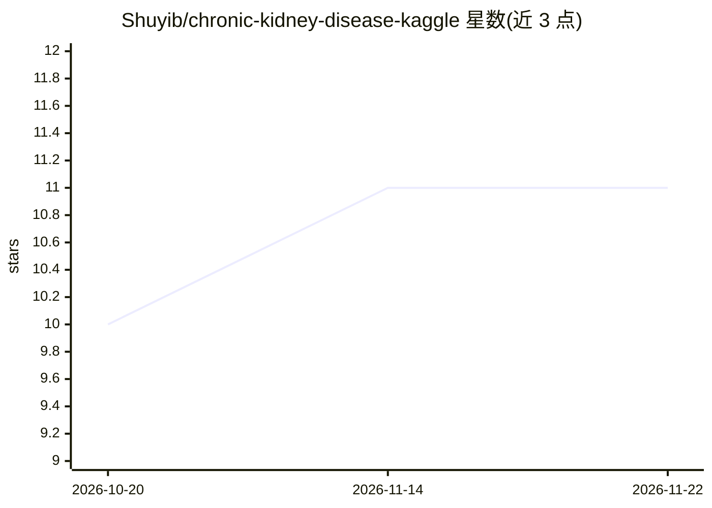

# Shuyib/chronic-kidney-disease-kaggle

⭐ 11 · Jupyter Notebook · CC0-1.0 · 推送 2026-01-21 · [GitHub](https://github.com/Shuyib/chronic-kidney-disease-kaggle) · 个人维护

**用机器学习模型预测慢性肾病并做结果解读**

基于 UCI/Kaggle 慢性肾病数据集（25 特征、400 条观测）的分析笔记本：使用数据清洗、数据压缩（PCA）等转换技术，评估逻辑回归与决策树分类器并报告 F1 分数；对每个分类器做特征重要性分析，并将结果与肾功能诊断检测关联以利于健康从业者理解。提供 Binder、Colab 在线运行入口，以及 pip 依赖安装和 Docker 镜像构建/运行方式。

## 筛选速览

| 维度 | 判定 | 备注 |
|---|---|---|
| AI 角色 | `ai-native` | 本体是模型或模型工具 |
| 许可风险 | `viral` | CC0-1.0 |
| 部署形态 | `self-host` | docker 或自建部署 |
| 模型依赖 | — | README 未给出锁定关系 |
| 硬件要求 | — | 无带数字的原话,不猜 |
| 安装摩擦 | `low` | 无编译、无系统依赖或容器化 |
| 成熟度 | — | 结构信号不足 |

## 能力要点

- 逻辑回归与决策树两类分类器的多种配置 F1 分数对比
- PCA 降维、标准化等数据转换流程
- 特征重要性解读并关联肾功能诊断检测
- 提供 Docker 镜像构建与运行方式

## 适用场景

- 学习肾病数据集的数据清洗与建模流程
- 为临床诊断辅助研究复现模型并尝试改进（如 SMOTE、LinearBoostClassifier）
- 向健康从业者演示模型结果的可解释性分析

## 场景标签

 · 领域:医疗健康/数据科学

## 证据(README 行号)

> L6: The data consists of 25 features and 400 observations consisting of various features that could be used to predict c
> L17: Within the notebook we go over feature importance for each classifier and also interpret what the results mean to t

## 星数曲线

2026-10-20 10 → 2026-11-22 11（+1）

---
*卡片 v1 · prompt 1.4 · 生成 2026-11-18 · 置信度 high · 依据 README sha `cdae04279db4` · [字段定义](../../DATASET.md)*
