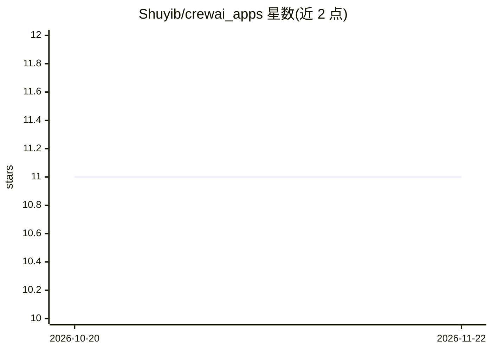

# Shuyib/crewai_apps

⭐ 11 · Python · Apache-2.0 · 推送 2026-07-27 · [GitHub](https://github.com/Shuyib/crewai_apps) · [官网](https://app.readytensor.ai/publications/the-ultimate-ai-editorial-duo-with-crewai-PboylfX1EYsf) · 个人维护

**基于 crewai 框架的多 agent 博客编辑工具**

使用 LLM 与 crewai 框架实现的博客编辑 agent 应用，通过 autogen agent 协作执行编辑任务。技术栈包括 streamlit（Web 界面）、crewai 与 openai 接口，基于 HuggingFace 上的 crewai gemini 示例改造。安装用 make install，运行用 make run，仓库另提供 GitHub Codespaces 与 HuggingFace 入口，许可证为 Apache 2.0。README 未给出配置细节或功能截图。

## 筛选速览

| 维度 | 判定 | 备注 |
|---|---|---|
| AI 角色 | `ai-native` | 本体是模型或模型工具 |
| 许可风险 | `permissive` | Apache-2.0 |
| 部署形态 | `None` |  |
| 模型依赖 | — | README 未给出锁定关系 |
| 硬件要求 | — | 无带数字的原话,不猜 |
| 安装摩擦 | `medium` | 含编译或系统依赖之一 |
| 成熟度 | — | 结构信号不足 |

## 能力要点

- 基于 crewai 框架编排多个协作 agent
- streamlit 提供 Web 界面
- 通过 openai 接口调用模型
- 提供 make install / make run 快捷命令

## 适用场景

- 用多 agent 协作编辑博客文章
- 学习 crewai 框架的 agent 编排用法
- 在 GitHub Codespaces 或 HuggingFace 上运行示例

## 场景标签

`多智能体` `AI 写作` · 领域:Agent 开发

## 证据(README 行号)

> L5: Blog Editor agent implemented with LLMs and crewai framework for handling autogen agents.
> L7: It uses streamlit, crewai and openai functions to execute the task of interest.

## 星数曲线

2026-10-20 11 → 2026-11-22 11（+0）

---
*卡片 v1 · prompt 1.4 · 生成 2026-11-18 · 置信度 mid · 依据 README sha `765e071b10ff` · [字段定义](../../DATASET.md)*
