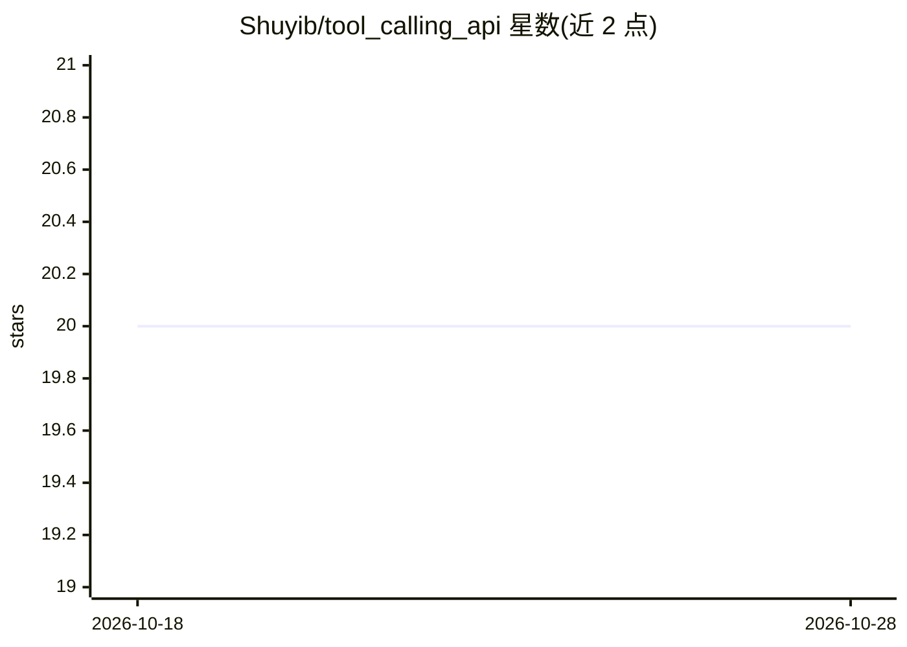

# Shuyib/tool_calling_api

⭐ 20 · Python · Apache-2.0 · 推送 2026-07-27 · [GitHub](https://github.com/Shuyib/tool_calling_api) · 个人维护

**用自然语言通过 Ollama 函数调用发短信/充话费的 AI agent**

基于 Python 与 Ollama 的函数调用示例项目：通过自然语言指令调用 Africa's Talking API 发送短信、充值话费、拨打电话（含 TTS 回调服务器），另含联网搜索、翻译、语音转文字等功能。以 Gradio 提供 Web 界面，集成 Inspect AI 安全层做调用前安全检查，Docker Compose 编排 ollama-server 与 Gradio 仪表盘两个容器。需 Africa's Talking 凭证，语音与数据功能需账户审批；建议 400MB-8GB 显存，也可 CPU 运行小模型。

## 筛选速览

| 维度 | 判定 | 备注 |
|---|---|---|
| AI 角色 | `ai-native` | 本体是模型或模型工具 |
| 许可风险 | `permissive` | Apache-2.0 |
| 部署形态 | `self-host` | docker 或自建部署 |
| 模型依赖 | local-ok | 支持本地模型 |
| 硬件要求 | — | 无带数字的原话,不猜 |
| 安装摩擦 | `low` | 无编译、无系统依赖或容器化 |
| 成熟度 | — | 结构信号不足 |

## 能力要点

- 自然语言指令映射为 Africa's Talking API 调用（SMS/话费/语音）
- Inspect AI 安全层对函数调用做安全检查与评测示例
- Gradio Web UI 与语音回调服务器（Edge TTS）
- Docker Compose 编排 ollama-server 与 Gradio 仪表盘

## 适用场景

- 不写代码，用自然语言给非洲手机号发短信、充话费
- 学习 Python + Ollama 的函数调用实现方式
- 体验带安全检查层的本地 LLM agent

## 场景标签

`AI 助手` `教程课程` · 领域:对话与助手

## 证据(README 行号)

> L3: Function-calling with Python and ollama. We are going to use the Africa's Talking API to send airtime, mobile data, 
> L99: ├── app.py - the function_call.py using gradio as the User Interface with AI safety layer.
> L120: │ └── inspect_safety.py - This file contains the Inspect AI safety layer implementation.

## 星数曲线

2026-10-18 20 → 2026-10-28 20（+0）

---
*卡片 v1 · prompt 1.4 · 生成 2026-10-28 · 置信度 high · 依据 README sha `1d0735e2d853` · [字段定义](../../DATASET.md)*
