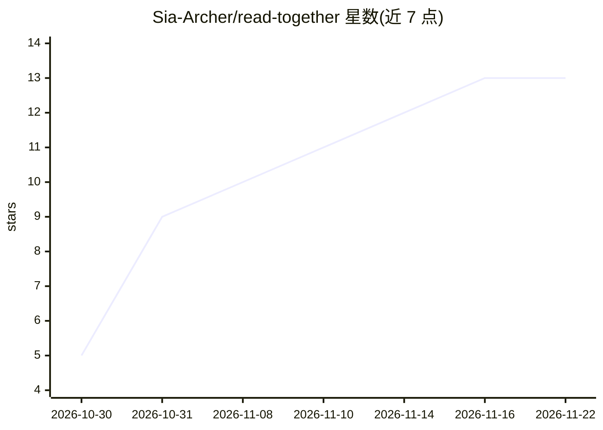

# Sia-Archer/read-together

⭐ 13 · JavaScript · MIT · 推送 2026-10-29 · [GitHub](https://github.com/Sia-Archer/read-together) · 个人维护 · 中文 README

**人和 AI 共读电子书的共享书房：同书库多入口与页边批注**

自托管的共读应用：网页书房负责藏书管理、EPUB/TXT 导入、阅读进度与批注；ChatGPT 组件和支持 MCP 的客户端通过 Books MCP 的七个工具进入同一书库，AI 可继续阅读、搜索全文、留下批注或回复读者的话。人与 AI 各自保留阅读进度，批注按渠道分别保存。运行需 Node.js 20.19+ 与 pnpm，三个服务默认仅监听本机，公开部署要求 HTTPS、身份验证与访问控制；README 提示公开版仍在整理中。基于 luoluo-1121/read-along 沿用 MIT 许可。

## 筛选速览

| 维度 | 判定 | 备注 |
|---|---|---|
| AI 角色 | `ai-enhanced` | 去掉 AI 部分产品仍成立 |
| 许可风险 | `permissive` | MIT |
| 部署形态 | `library` | 以包/库形式分发 |
| 模型依赖 | — | README 未给出锁定关系 |
| 硬件要求 | — | 无带数字的原话,不猜 |
| 安装摩擦 | `low` | 无编译、无系统依赖或容器化 |
| 成熟度 | `idea` | |

## 能力要点

- Books MCP 提供七个工具，ChatGPT 与其他 MCP 客户端共用同一套
- 人与 AI 各自独立阅读进度，AI 读书不移动人的进度
- 网页导入 EPUB/TXT，自动识别书名和作者
- 在读/未读/已读书架、回收站与共读记录

## 适用场景

- 我想和 AI 各自读书，在想分享时把彼此带到同一句话前
- 在 ChatGPT 对话里继续翻看网页书房的划线和批注
- 用 MCP 客户端让 AI 搜索整本书并留下批注

## 场景标签

`文档问答` · 领域:知识与检索

## 证据(README 行号)

> L9: Read Together 是一间给人和 AI 一起读书的开源共享书房。
> L27: - **支持 MCP 的客户端**：通过书房提供的工具访问同一个书库，让 AI 接着阅读、搜索、留下批注或回应；具体界面取决于客户端。
> L50: Books MCP 给 AI 准备了七个工具，ChatGPT 和其他 MCP 客户端用的是同一套：

## 星数曲线

2026-10-30 5 → 2026-11-22 13（+8）

---
*卡片 v1 · prompt 1.4 · 生成 2026-11-18 · 置信度 high · 依据 README sha `423a009e7c62` · [字段定义](../../DATASET.md)*
