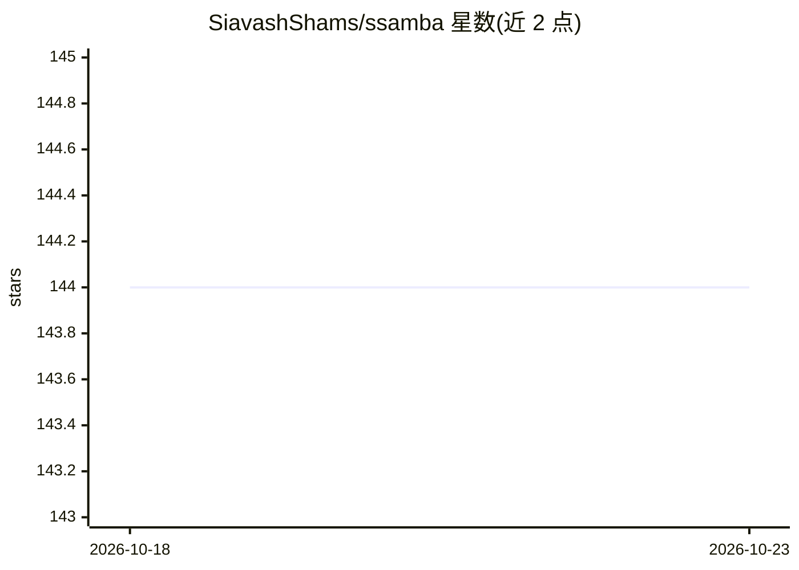

# SiavashShams/ssamba

⭐ 144 · Python · BSD-3-Clause · 推送 2025-11-05 · [GitHub](https://github.com/SiavashShams/ssamba) · 个人维护

**基于 Mamba 状态空间模型的自监督音频表征学习官方实现**

SLT 2024 论文 SSAMBA 的 PyTorch 官方实现：以 Mamba 状态空间模型为骨干，在 AudioSet 与 LibriSpeech 无标注音频混合数据上做自监督掩码预训练，提供 base/small/tiny 三种规模、250/300/400 三种掩码 patch 数的预训练权重。支持在 AudioSet、ESC-50、Speech Commands V2、VoxCeleb、IEMOCAP 等数据集上微调，覆盖音频分类、关键词检出、说话人识别与语音情感识别任务；VoxCeleb/IEMOCAP 微调需配合 SUPERB(s3prl) 包与 Vision Mamba 仓库使用。

## 筛选速览

| 维度 | 判定 | 备注 |
|---|---|---|
| AI 角色 | `ai-native` | 本体是模型或模型工具 |
| 许可风险 | `permissive` | BSD-3-Clause |
| 部署形态 | `library` | 以包/库形式分发 |
| 模型依赖 | — | README 未给出锁定关系 |
| 硬件要求 | — | 无带数字的原话,不猜 |
| 安装摩擦 | `low` | 无编译、无系统依赖或容器化 |
| 成熟度 | — | 结构信号不足 |

## 能力要点

- Mamba 状态空间骨干的自监督音频预训练（PyTorch 实现）
- 提供 base/small/tiny 三种规模的预训练权重
- 覆盖 AudioSet/ESC-50/Speech Commands/VoxCeleb/IEMOCAP 微调脚本
- VoxCeleb 与 IEMOCAP 微调通过 SUPERB(s3prl) 流程进行

## 适用场景

- 下载预训练权重微调做音频分类或关键词检出
- 复现论文中的说话人识别与语音情感识别实验
- 在自有无标注音频上重新预训练模型

## 场景标签

`微调` `模型训练` · 领域:训练与推理

## 证据(README 行号)

> L16: This repository contains the official implementation (in PyTorch) of the the paper SSAMBA: Self-Supervised Audio Re
> L46: We pretrained SSAMBA with various sizes (base, small, tiny) for patches (250, 300, and 400) on a mixture of unlabel

## 星数曲线

2026-10-18 144 → 2026-10-23 144（+0）

---
*卡片 v1 · prompt 1.4 · 生成 2026-10-22 · 置信度 mid · 依据 README sha `c8b133ee019f` · [字段定义](../../DATASET.md)*
