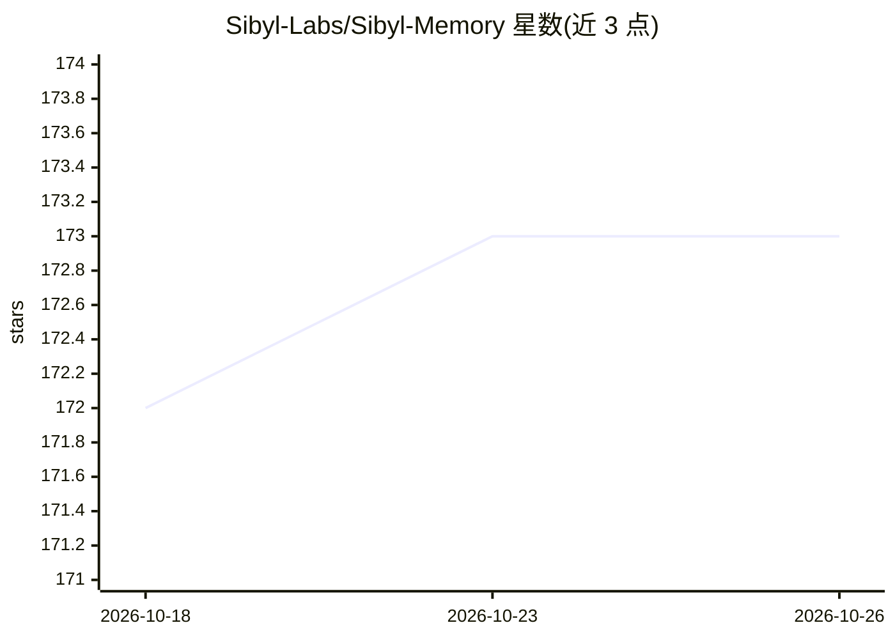

# Sibyl-Labs/Sibyl-Memory

⭐ 173 · Python · MIT · 推送 2026-10-14 · [GitHub](https://github.com/Sibyl-Labs/Sibyl-Memory) · [官网](https://sibyllabs.org/plugin) · 组织维护

**AI agent 的本地文件式长期记忆插件族（五包）**

面向 agent 开发者的记忆基础设施，发布为五个 PyPI 包：SDK、CLI、MCP server、Hermes 适配器与 LangGraph BaseStore 适配器。底层为单文件 SQLite，五层分级 schema 与 FTS5 全文检索，无向量库、无嵌入模型。需激活账号方可使用记忆工具（代码 MIT，可 fork 移除账号校验），免费版有容量上限，Pro/Elite 解锁自学习、记忆 linter 与自动保存/去膨胀等托管功能。运行于 Linux/macOS/WSL2，不支持原生 Windows。作者声明由 Sibyl Labs LLC 的自主 agent 产出，并在 LongMemEval Oracle 榜单公开结果。

## 筛选速览

| 维度 | 判定 | 备注 |
|---|---|---|
| AI 角色 | `ai-ecosystem` | LLM/agent 周边工具 |
| 许可风险 | `permissive` | MIT |
| 部署形态 | `library` | 以包/库形式分发 |
| 模型依赖 | locked-api |  |
| 硬件要求 | — | 无带数字的原话,不猜 |
| 安装摩擦 | `low` | 无编译、无系统依赖或容器化 |
| 成熟度 | — | 结构信号不足 |

## 能力要点

- SQLite 单文件 + 五层 schema（HOT/WARM/COLD/REFERENCE/ARCHIVE）+ FTS5 检索，无向量库无嵌入
- 五个 PyPI 包：client SDK、CLI、MCP server、Hermes 适配、LangGraph BaseStore
- 会话保存（save）与指令文件去膨胀（debloat）生命周期，含 Claude Code hooks
- 记忆内容不出本机；账号校验仅传输激活/配额/遥测元数据

## 适用场景

- 给我的 coding agent 接上跨会话的本地长期记忆
- 通过 MCP 让 Claude Code / Cursor / Codex 读写记忆
- 给 LangGraph 多线程 agent 提供持久 BaseStore
- 自动精简 CLAUDE.md / AGENTS.md 等膨胀的指令文件

## 场景标签

`Agent 记忆` · 领域:Agent 开发

## 证据(README 行号)

> L27: `sibyl-memory-client` is a local-first agentic memory SDK. SQLite-backed, five-tier hierarchical schema, FTS5 searc
> L31: The other four packages ride on top: `sibyl-memory-cli` for activation and tier management, `sibyl-memory-hermes` f

## 星数曲线

2026-10-18 172 → 2026-10-26 173（+1）

---
*卡片 v1 · prompt 1.4 · 生成 2026-10-22 · 置信度 high · 依据 README sha `6e3d16b68ae1` · [字段定义](../../DATASET.md)*
