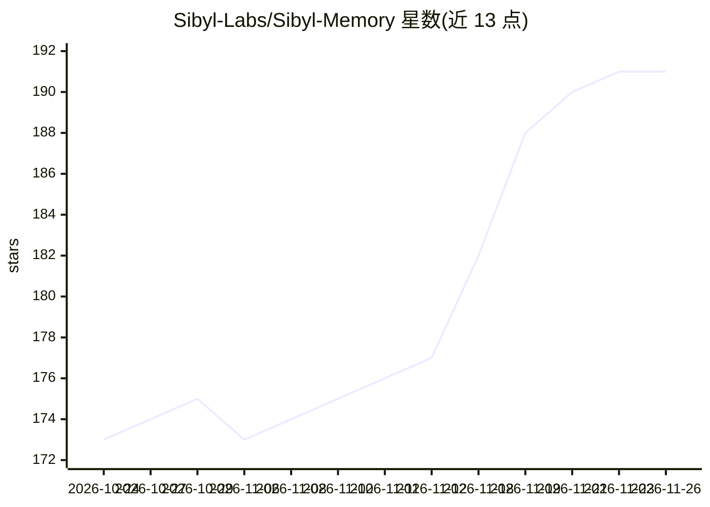

# Sibyl-Labs/Sibyl-Memory

⭐ 191 · Python · MIT · 推送 2026-11-19 · [GitHub](https://github.com/Sibyl-Labs/Sibyl-Memory) · [官网](https://sibyllabs.org/products/memory) · 组织维护

**为 AI agent 提供本地文件式长期记忆的插件族**

五个 PyPI 包构成的记忆插件族：本地优先的 SDK（SQLite、五层分级 schema、FTS5 搜索、多租户）、CLI、MCP server、Hermes 适配器和 LangGraph BaseStore，不使用向量库与嵌入。提供会话结束保存（journal/实体/状态/归档）与上下文文件瘦身（debloat）功能。使用需注册账号激活，entitlement 需定期在线续期（离线最长 14 天）；本地引擎为 MIT，fork 可去除账号检查但失去托管端功能。

## 筛选速览

| 维度 | 判定 | 备注 |
|---|---|---|
| AI 角色 | `ai-ecosystem` | LLM/agent 周边工具 |
| 许可风险 | `permissive` | MIT |
| 部署形态 | `library` | 以包/库形式分发 |
| 模型依赖 | — | README 未给出锁定关系 |
| 硬件要求 | — | 无带数字的原话,不猜 |
| 安装摩擦 | `low` | 无编译、无系统依赖或容器化 |
| 成熟度 | — | 结构信号不足 |

## 能力要点

- SQLite + FTS5 五层分级记忆，无向量数据库与嵌入模型
- MCP server 供 Claude Code/Codex/Cursor/Continue 等接入
- LangGraph BaseStore 适配器与 Hermes Agent 集成包
- 会话保存与上下文文件瘦身（save/debloat）流程

## 适用场景

- 给 Claude Code/Codex 等编码 agent 加跨会话长期记忆
- 为 LangGraph 应用提供持久化跨线程 store
- 在无向量基础设施的单机上运行 agent 记忆

## 场景标签

`Agent 记忆` · 领域:Agent 开发

## 证据(README 行号)

> L27: `sibyl-memory-client` is a local-first agentic memory SDK. SQLite-backed, five-tier hierarchical schema, FTS5 searc
> L31: The other four packages ride on top: `sibyl-memory-cli` for activation and tier management, `sibyl-memory-hermes` f
> L44: |`sibyl-memory-mcp`|PyPI|MCP server. Wraps the local SQLite + FTS5 memory engine and exposes it to MCP-compatible a

## 星数曲线

2026-10-24 173 → 2026-11-26 191（+18）

---
*卡片 v1 · prompt 1.4 · 生成 2026-11-26 · 置信度 high · 依据 README sha `cc04fd271a29` · [字段定义](../../DATASET.md)*
