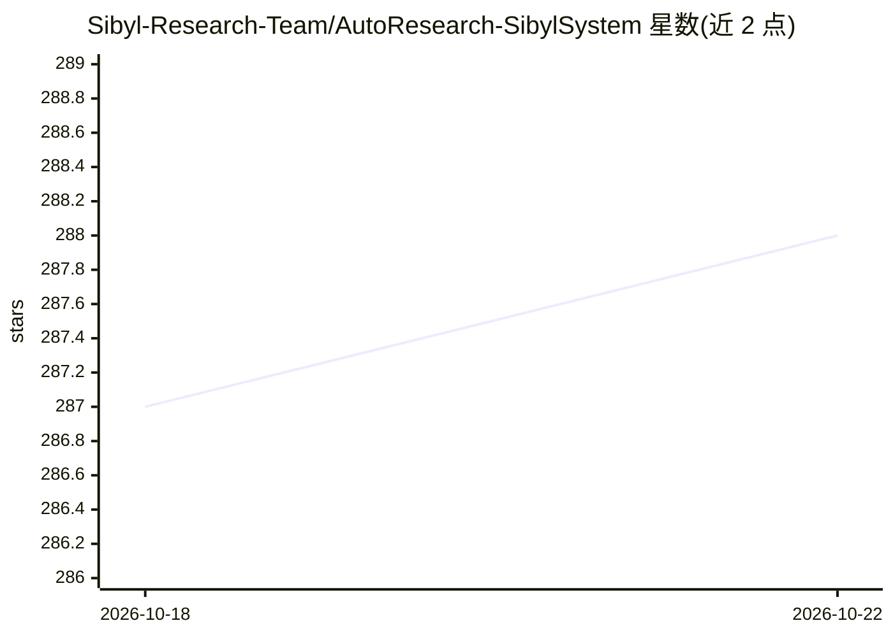

# Sibyl-Research-Team/AutoResearch-SibylSystem

⭐ 288 · Python · 推送 2026-03-25 · [GitHub](https://github.com/Sibyl-Research-Team/AutoResearch-SibylSystem) · 组织维护 · 中文 README

**全自动 AI 科研系统：从选题到论文无人干预**

构建于 Claude Code 之上的端到端 ML 科研自动化系统：20+ 个专职 agent 组成 19 阶段流水线，覆盖文献调研、多 agent 观点辩论、实验规划与 GPU 远程并行执行、论文撰写与多 agent 交叉评审。采用双循环架构：内循环按质量门控迭代改进研究各维度，外循环从每次迭代提取经验教训并自动更新自身 agent 提示词与调度策略。运行需 Python 3.12+、Node.js 18+、Claude Code CLI、ANTHROPIC_API_KEY 与 SSH 可达的 GPU 服务器；自主运行依赖 --dangerously-skip-permissions 免确认模式。另提供浏览器 WebUI 监控项目、agent、GPU 与 token 消耗。

## 筛选速览

| 维度 | 判定 | 备注 |
|---|---|---|
| AI 角色 | `ai-native` | 本体是模型或模型工具 |
| 许可风险 | `permissive` | — |
| 部署形态 | `library` | 以包/库形式分发 |
| 模型依赖 | locked-api |  |
| 硬件要求 | — | 无带数字的原话,不猜 |
| 安装摩擦 | `low` | 无编译、无系统依赖或容器化 |
| 成熟度 | — | 结构信号不足 |

## 能力要点

- 20+ AI agent、19 阶段流水线覆盖文献调研到论文撰写
- 通过 SSH MCP 在远程 GPU 服务器上并行执行实验（含调度与租约管理）
- 外循环自进化：跨项目积累经验并自动更新 agent 提示词与调度策略
- 浏览器 WebUI 实时监控项目状态、agent、GPU 与 token 成本

## 适用场景

- 给定研究课题，自动完成文献调研、GPU 实验与会议级论文撰写
- 将文献检索、观点辩论等单一流水线阶段作为独立科研工具使用
- 用自然语言描述研究方向，由系统自主完成探索（Vibe Research）

## 场景标签

`多智能体` `科研工具` · 领域:Agent 开发

## 证据(README 行号)

> L16: Sibyl is a **fully autonomous AI scientist** that drives end-to-end ML research — from literature survey and hypoth
> L22: - **Inner Loop — Research Iteration**: Each project automatically iterates across every dimension — refining hypoth

## 星数曲线

2026-10-18 287 → 2026-10-22 288（+1）

---
*卡片 v1 · prompt 1.4 · 生成 2026-10-22 · 置信度 mid · 依据 README sha `fbe5af1d6592` · [字段定义](../../DATASET.md)*
