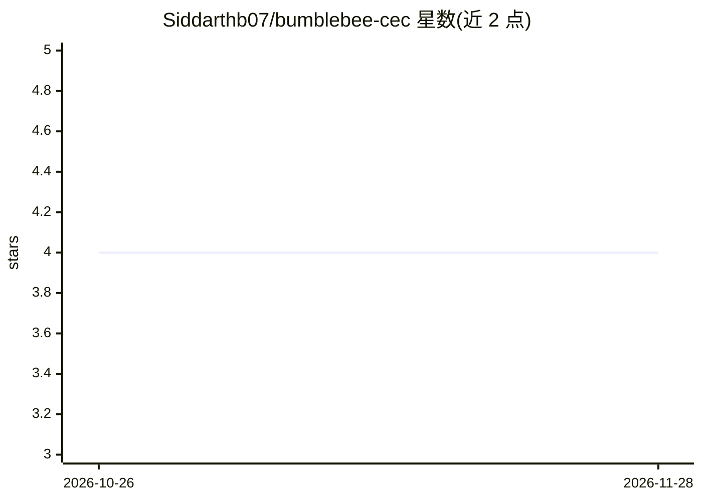

# Siddarthb07/bumblebee-cec

⭐ 4 · Python · MIT · 推送 2026-10-29 · [GitHub](https://github.com/Siddarthb07/bumblebee-cec) · 个人维护

**封闭语料问答相关器：引用出处或拒答，非聊天 LLM**

Bumblebee CEC 是一个封闭语料相关器：输入问题后从冻结语料包中作答并引用出处段落，证据不足时拒答。核心机制为 CEC（Correlated Evidence Cells）：GRU 读取问题与段落，sparsemax SoftCorrelator 将概率质量分配到匹配单元，覆盖率门控判定质量是否足以作答。回答路径不含 Hugging Face transformer，聊天/数学/短代码回复由技能包与工具提供。不随附 cec.pt 检查点（需经 Git LFS 获取或自行训练），核心 CEC 功能须先 train/calibrate。CLI 提供 ask/chat/dash/train/eval/seal 等命令，dash 在本地 7860 端口起聊天 UI。

## 筛选速览

| 维度 | 判定 | 备注 |
|---|---|---|
| AI 角色 | `ai-native` | 本体是模型或模型工具 |
| 许可风险 | `permissive` | MIT |
| 部署形态 | `library` | 以包/库形式分发 |
| 模型依赖 | — | README 未给出锁定关系 |
| 硬件要求 | — | 无带数字的原话,不猜 |
| 安装摩擦 | `low` | 无编译、无系统依赖或容器化 |
| 成熟度 | — | 结构信号不足 |

## 能力要点

- GRU + sparsemax SoftCorrelator + 覆盖率门控的引用或拒答机制
- OOD 拒答 recall 0.849（dim=640，127,106,806 参数）
- 回答路径无 Hugging Face transformer；聊天/计算来自技能包与工具并标注 source=
- SHA-256 封印校验语料包（11,568 段落）未漂移

## 适用场景

- 在封闭语料上做带出处引用的问答
- 需要拒答不确定问题以避免编造的场景
- 在无 GPU 的本机上训练与评估小型相关器模型

## 场景标签

`文档问答` · 领域:知识与检索

## 证据(README 行号)

> L3: Bumblebee is a **closed-corpus correlator**. You ask a question. It answers from a frozen pack and cites the passage
> L5: It is not a frontier next-token language model. There is no Hugging Face transformer in the answer path. Chat, math,
> L43: python -m bumblebee.cli ask "What is photosynthesis?" --mode corpus

## 星数曲线

2026-10-26 4 → 2026-11-28 4（+0）

---
*卡片 v1 · prompt 1.4 · 生成 2026-11-21 · 置信度 high · 依据 README sha `69882791daef` · [字段定义](../../DATASET.md)*
