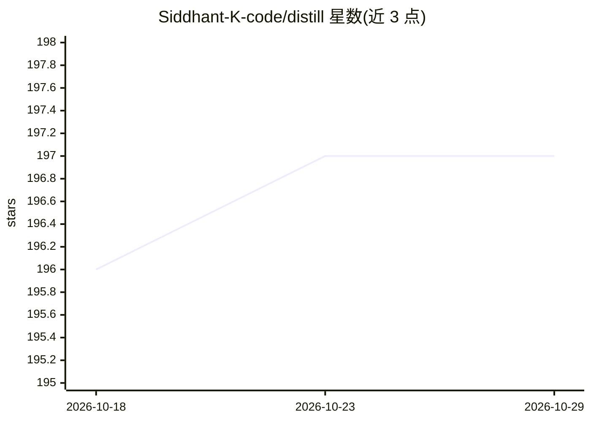

# Siddhant-K-code/distill

⭐ 197 · Go · MIT · 推送 2026-09-30 · [GitHub](https://github.com/Siddhant-K-code/distill) · [官网](https://distill.siddhantkhare.com) · 个人维护

**给 LLM agent 的持久记忆与上下文去重压缩层**

Go 编写的上下文处理服务，为 LLM agent 提供跨会话持久记忆：写入时去重、敏感度标记、冲突检测，召回按相关性与时近排序，并按访问模式分层衰减（全文→摘要→关键词→逐出）。另提供检索去重管线（过采→聚类→代表选择→MMM 重排）、token 预算的会话管理、Distill Lock 上下文构建产物冻结及 Handoff 决策审查工具。全程无 LLM 调用、确定性，约 12ms 开销。以 CLI 与 HTTP API（含 Swagger 文档）形式提供，支持 MCP 接入 Claude/Cursor 等，可接 Pinecone/Qdrant，OpenAI key 仅用于 embeddings（可用预计算向量替代）。

## 筛选速览

| 维度 | 判定 | 备注 |
|---|---|---|
| AI 角色 | `ai-ecosystem` | LLM/agent 周边工具 |
| 许可风险 | `permissive` | MIT |
| 部署形态 | `desktop` | 安装包/桌面程序 |
| 模型依赖 | — | README 未给出锁定关系 |
| 硬件要求 | — | 无带数字的原话,不猜 |
| 安装摩擦 | `low` | 无编译、无系统依赖或容器化 |
| 成熟度 | `idea` | |

## 能力要点

- 写入时去重、敏感度标记与冲突检测的持久记忆，跨会话保留
- 分层衰减压缩：全文→摘要(~20%)→关键词(~5%)→逐出，访问可重置
- 确定性去重管线（过采→凝聚聚类→代表选择→MMR 重排），无 LLM 调用，约 12ms
- MCP 集成：Claude Desktop、Cursor 等 MCP 客户端可直接使用记忆与会话工具

## 适用场景

- 让 agent 跨会话记住用户约束、偏好与事实，避免重复学习
- 检索结果送入 LLM 前去重，控制上下文冗余
- 长会话按 token 预算自动压缩与逐出旧条目
- 将审定的上下文冻结为可校验的构建产物（Distill Lock/Handoff）

## 场景标签

`Agent 记忆` · 领域:Agent 开发

## 证据(README 行号)

> L12: Distill gives LLM agents persistent, deduplicated memory that survives across sessions. It prevents repeated re-lea
> L273: ## Context Memory
> L250: ### 3. MCP Integration (AI Assistants)

## 星数曲线

2026-10-18 196 → 2026-10-29 197（+1）

---
*卡片 v1 · prompt 1.4 · 生成 2026-10-22 · 置信度 mid · 依据 README sha `c5cdd796eb11` · [字段定义](../../DATASET.md)*
