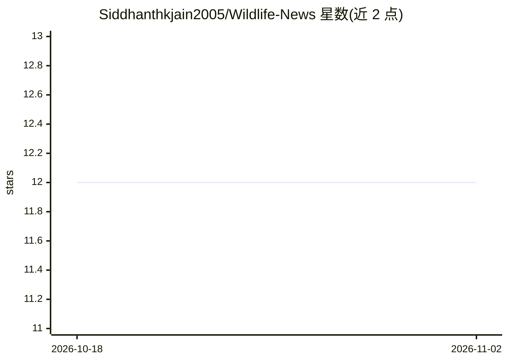

# Siddhanthkjain2005/Wildlife-News

⭐ 12 · Python · 推送 2026-10-05 · [GitHub](https://github.com/Siddhanthkjain2005/Wildlife-News) · [官网](https://wildlifenews.azurewebsites.net) · 组织维护

**面向印度野生动物犯罪监测的情报工作台，多语言新闻汇聚分析**

与 Wildlife Trust of India 合作开发的野生动物犯罪情报工作台：汇集多语种新闻来源，经采集去重后进行分类、实体抽取、风险评分与热点预测，提供全国威胁地图、实时告警、语义检索数据库、关系网络分析、投诉起草与导出（CSV/Excel/PDF）等模块。后端 FastAPI + SQLAlchemy + WebSockets，前端 React + Vite + Leaflet，默认 SQLite 单实例部署，可选本地 AI 模型包与外部模型网关。声明自动分析结果需人工复核，非已验证结论或法律判定。

## 筛选速览

| 维度 | 判定 | 备注 |
|---|---|---|
| AI 角色 | `ai-native` | 本体是模型或模型工具 |
| 许可风险 | `none` | — |
| 部署形态 | `library` | 以包/库形式分发 |
| 模型依赖 | — | README 未给出锁定关系 |
| 硬件要求 | — | 无带数字的原话,不猜 |
| 安装摩擦 | `low` | 无编译、无系统依赖或容器化 |
| 成熟度 | — | 结构信号不足 |

## 能力要点

- 多语种新闻采集去重 + NLP 分类、实体抽取与风险评分
- 全国威胁地图、WebSocket 实时高风险告警与预测热点
- 语义/关键词混合检索的事件数据库与关系网络分析
- FastAPI 后端 + React 前端，SQLite 默认、可选 PostgreSQL 与本地 AI 模型包

## 适用场景

- 保护团队集中审阅分散于多语种新闻的野生动物犯罪事件
- 识别盗猎模式与高风险区域并准备应对方案
- 起草投诉材料、生成情报简报与分析档案

## 场景标签

`网页抓取` `语义搜索` `数据分析` · 领域:效率与自动化

## 证据(README 行号)

> L18: The platform supports human investigation. Automated classifications, risk scores, forecasts, and legal drafts requ
> L48: - **Intelligence:** Configurable NLP classifiers, entity extraction, hybrid search, and external model gateways. Op
> L73: For optional local AI models, install `requirements-ai.txt` after checking available RAM and disk space. Without op

## 星数曲线

2026-10-18 12 → 2026-11-02 12（+0）

---
*卡片 v1 · prompt 1.4 · 生成 2026-11-01 · 置信度 high · 依据 README sha `da0cd1f5f954` · [字段定义](../../DATASET.md)*
